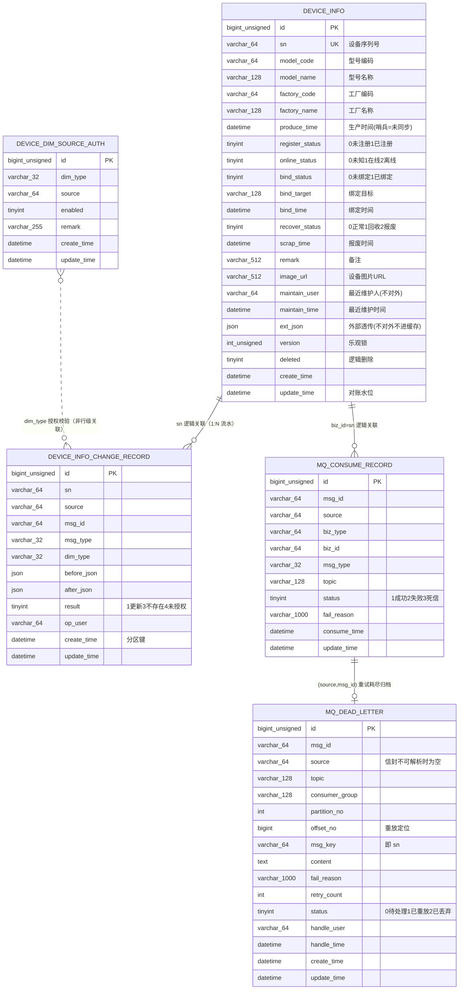
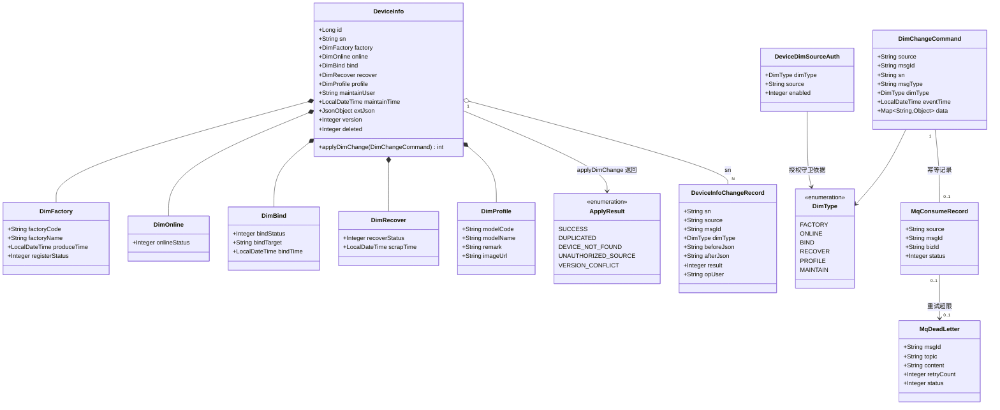
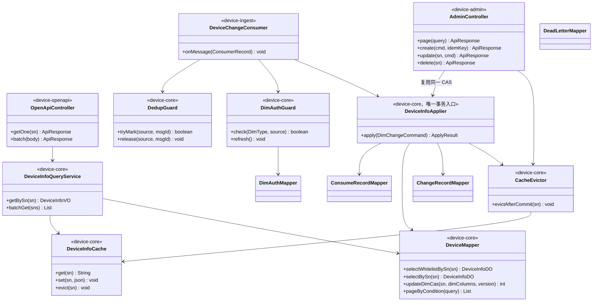

# 设备管理后端（充电宝设备）数据模型设计文档

> **模板**: `.qoder/skills/tech-generate/templates/data-model-template.md`
> **关联技术设计**: [../tech-design.md](../tech-design.md)
> **关联规范**:`.aisdd/rules/` 下的 `mysql_specification.md`（建表与索引【强制】条款）、`redis_specification.md`（Key 命名与 TTL）、`mq_specification.md`（幂等表与死信表）、`java_springboot_specification.md`（版本化迁移、配置键 kebab-case）

---

## 1. 文档信息

| 属性 | 值 |
|------|-----|
| **文档版本** | V1.1.2（V1.1.0 审核校订 + V1.1.1 实现映射回写 + V1.1.2 技术评审回写，见 §2） |
| **关联 PRD** | **缺失** —— 输入为 2026-10-29 需求方口述，同 `tech-design.md` §1.1 偏差声明 |
| **关联概要/详细设计** | `tech-design.md` V1.3.0（**已评审、未锁定**：`tech-review` 结论为不通过，见 `../review_reports/tech_review.json`） |
| **关联实现映射** | `../implementation-map.md`（本文件的 DDL 落在 `IM-DB-001`，表/列对应 DO 与 Mapper 落在 `IM-CORE-002`，配置键与依赖落在 `IM-BUILD-001` / `IM-OPS-001`） |
| **需求规模** | 中型 —— 新增 5 张表，无历史数据 |
| **创建日期** | 2026-10-29 |
| **作者** | AI Agent |

---

## 2. 版本修订记录

| 版本号 | 修订日期 | 修订人 | 关联 PRD 版本 | 变更类型 | 变更描述 | 影响范围 |
|-------|---------|-------|-------------|---------|---------|---------|
| V1.0.0 | 2026-10-29 | AI Agent | 无 PRD（口述） | 新建 | 初始版本：设备主档 + 变更流水 + MQ 三表 + 维度授权配置 | 全文 |
| V1.1.0 | 2026-10-29 | AI Agent | 无 PRD（口述） | 修订 | 审核校订：`mq_dead_letter` 补 `consumer_group`；E-R 图与 DDL 逐列对齐并补两条边的读法说明；类图去掉 `DeviceInfo` 与 `DimProfile` 重复的 `modelCode/modelName`、`selectBySnForUpdate_free` 改 `selectBySn` 并写明"不加行锁 + 列名只能取自 `DimSpec`"；配置键全文统一 kebab-case（`java_springboot`【强制】）；§9.1~§9.2 初始化改为 Flyway 版本化迁移交付 + 分区预建 + 发布门禁 | §1、§4、§5、§6.4、§7.4、§9.1、§9.2、全文配置键 |
| V1.1.1 | 2026-10-29 | AI Agent | 无 PRD（口述） | 修订（实现映射回写） | 同步 `tech-design` V1.2.0 的 G-001/G-003：Redis Key 清单（§技术栈表与 §附录 一致性检查表）补 `device:lock:cron:{job}`、`device:cron:watermark:cache-reconcile`、`device:admin:idem:{key}` 三项。**表结构无变化**（无新增列/表/索引），因此不产生新的 Flyway 迁移脚本 | §5 技术栈表、§附录 一致性检查表 |
| V1.1.2 | 2026-10-29 | AI Agent（`tech-review` 四角色评审回写） | 无 PRD（口述） | 修订（**表结构未变**，只改交付形态与引用版本） | ①**§9.1/§9.2 的 DDL 交付形态由"已定"改回"待裁决"**：需求方在评审后给出"DDL 不需要迁移"，本轮按"不把 §6 的 DDL 落成 `.sql` 脚本文件"执行，因此仓库内**不存在** `V1__device_init_tables.sql` / `V2__device_dim_source_auth.sql`；若真实含义是"不用 Flyway、上线人工执行 DDL"，则 `java_springboot`【强制】的版本化迁移条款**不满足、需豁免留痕**（登记为 `tech-design` 附录 E #12）。②§9.2 步 1（三进程只有一个执行迁移）与步 5（预建分区脚本）在裁决前不能当作已落实。③§8.5 索引评估补 EP-010 流水查询**无分区裁剪**的事实（`tech-design` §9.1 V1.3.0 更正同步）。④附录 C 的引用版本改为 `tech-design` V1.3.0、契约 v1.2.1，并补评审产物与实现映射的真实路径。**本文档不声称任何脚本已产出** | §1、§2、§8.5、§9.1、§9.2、附录 C |
| V1.1.3 | 2026-10-29 | AI Agent（编码启动回写） | 无 PRD（口述） | 修订（**表结构未变**，只把 §9 的 DDL 交付形态由"待裁决"改为"已定稿"） | 同步 `tech-design` V1.3.1：需求方裁决"DDL 不需要迁移"后，附录 E #12 的两种读法对代码处置一致，故**关闭待裁决状态**——① 本期不引 `flyway-core`、不产出 `db/migration/*.sql`，§6 DDL 由运维人工执行，`java_springboot` §迁移【强制】记为**有意偏离 + 豁免留痕**；② §9.2 步 1 由"只有一个进程执行迁移"改写为"人工执行 + 发布前检查已执行"（执行记录回写 `implementation-map` IM-DB-001），步 2~4 去掉"迁移"字样；③ 明确仓库唯一的 `.sql` 是测试夹具 `device-core/src/test/resources/db/test-schema.sql`（内容逐字取自 §6，与 §6 差异即缺陷），并写出它为什么必须存在（禁 H2 + 无 Flyway 两条硬约束同时成立）与两条补偿措施；④ 步 6 发布门禁改挂到"人工脚本入库前评审 + EP-012 加载时 ERROR 日志"，**不新增指标键**（`§11.1` 未登记）。①起的全部改动只涉及交付与运维形态，**列、类型、默认值、索引、分区定义在 V1.1.3 未发生任何变化** | §2、§9.1、§9.2 |

---

## 3. 数据模型概述

### 3.1 设计原则

| # | 原则 | 落地方式 |
|---|------|---------|
| P1 | **主档只承载"当前值"，历史一律进流水** | `device_info` 每 SN 一行；每次变化写 `device_info_change_record` |
| P2 | **四个维度正交，一条消息只写自己那组列** | 更新用动态列 `<set>`，禁止全字段覆盖（`tech-design` R10） |
| P3 | **不发明冗余列**：能被流水/其它表承载的信息不在主档重复存 | 各维度"最后同步时间"由流水的 `create_time` 承载，主档**不加 4 个 `sync_time` 列** |
| P4 | **正确性靠约束，不靠代码约定** | 幂等 = 唯一索引；并发 = `version` CAS；跨源覆盖 = 授权表 |
| P5 | **规范优先** | 表名单数小写、`id/create_time/update_time` 三字段、`NOT NULL` + 默认值、`utf8mb4`、每列注释 |
| P6 | **可分区的不承载唯一约束，承载唯一约束的不分区** | 见 §8.3 |
| P7 | **字段可见性与缓存 Value 同源** | 主档字段分三组：对外白名单 / 仅对账 / 仅内部（§7.1 可见性列标注） |

### 3.2 业务实体清单

| 实体 | 表名 | 类型 | 量级（假设值） | 增长模式 | 保留策略 |
|------|------|------|--------------|---------|---------|
| 设备主档 | `device_info` | 业务主数据 | 10 万行 | 随建档增长，不随消息量增长 | 永久（逻辑删） |
| 设备变更流水 | `device_info_change_record` | 事实/审计 | ~43 万行/日 | 线性快增 | 按月分区，保留 `${device.record.retention-months:12}`（待确认）后 `DROP PARTITION` |
| 消费幂等记录 | `mq_consume_record` | 中间件标准表 | ~43 万行/日 | 线性增长 | 不分区，分批 DELETE，保留 90 天（待确认） |
| 死信归档 | `mq_dead_letter` | 中间件标准表 | 正常 < 1000 行 | 应为异常信号 | 永久（人工处理） |
| 维度权威源配置 | `device_dim_source_auth` | 配置 | < 100 行 | 极慢 | 永久 |

---

## 4. E-R 图 ⭐

### 4.1 整体 E-R 图



> **关系说明（重要）**：本模型**不建物理外键**。`device_info_change_record.sn`、`mq_consume_record.biz_id` 与 `device_info.sn` 是**逻辑关联**——理由：① 本系统主档写入路径只有"消费落地"和"后台维护"两处，一致性由程序保证；② 消息到达时主档可能尚未建档（`result=3 设备不存在` 正是为此设计的合法状态），物理外键会让这类消息直接报错进死信，破坏 §8 设计的留痕能力；③ 流水表按月分区，外键在分区表上受限且会增加分区维护成本。
>
> **两条边的读法**：
> - `mq_consume_record` ↔ `mq_dead_letter` **不是 1:1**。同一条 `(source, msg_id)` 可能先写"失败待重试"、耗尽后进死信，重放成功后再进一次死信；两表用 `(source, msg_id)` 关联查询，**不互相持有外键**。
> - `device_dim_source_auth` ↔ `device_info_change_record` **是校验依赖，不是行级关联**。授权表的 `dim_type` 决定"某 source 能不能写某维度"，流水的 `dim_type` 记录"本次处理影响的维度"；二者同字典（§8.4），但一条授权行对应任意多条流水，反之流水的 `result=4` 恰恰表示**没有**匹配的授权行。图中用虚线（`..`）表示这一层非数据依赖。

### 4.2 新增/变更字段标注

本次为全新建表，无既有表变更。与需求会话早期草案的差异（**已按本仓库规范定稿**）：

| 早期草案 | 定稿 | 原因 |
|---------|------|------|
| `gmt_create` / `gmt_modified` | `create_time` / `update_time` | `mysql_specification.md` §1.1【强制】表必备三字段 |
| 4 个维度各带 `xxx_sync_time` | **删除** | 无 `event_time` 后该列对正确性零贡献（TD-004）；同步时间由流水 `create_time` 承载，避免冗余列 |
| 设备图片子表 `t_device_image` | 主档单列 `image_url` | 需求方裁决"只要一张图" |
| 事件明细表（高频上报流水） | 不建 | 范围收窄：本系统不直连设备，无高频遥测 |
| `t_device_lifecycle_record`（生命周期） | 改为 `device_info_change_record` | 不做生命周期流转，只留维度变更痕迹 |
| `maintain_user` 进缓存与对外 | 不进缓存、不对外 | 需求方裁决 |

---

## 5. 类图 ⭐

### 5.1 领域模型类图



> **设计要点与读法**：
> - **维度对象（Dim\*）只用于表达"一条消息能碰哪些列"，不引入状态机校验方法**——`DeviceInfo.applyDimChange` 只负责"按维度列 + `version` 生成 CAS"，流转合法性归外部系统（`tech-design` §7.4 (b)、R-004）。
> - 维度对象是**逻辑聚合视图**：落库仍是 `device_info` 单表平铺列，DO 不嵌套（§6.1）。`modelCode / modelName` 归 `DimProfile`，`DeviceInfo` 不重复持有，避免同一列出现两个写入入口。
> - **`DimChangeCommand.eventTime` 当前恒为 `null`**：外部消息契约缺 `event_time`（`tech-design` R-001，违反 MQ 规范 §1.3【强制】）。字段保留是为后续升级为乱序水位仲裁（TD-004 方案 A）留位，**本期任何代码都不得依赖它做比较**。
> - `ApplyResult` 的 `DUPLICATED` / `VERSION_CONFLICT` **不写入流水 `result` 列**（附录 B 口径：重复走唯一键冲突整事务回滚、冲突走重试→死信，同一事实不在两处记两种口径）。
> - 类图只画关键属性，`DeviceInfoChangeRecord` / `MqConsumeRecord` / `MqDeadLetter` 省略了 `id`、`create_time`、`update_time` 等列；**字段全集以 §6 DDL 与 §7 对照表为准**。

### 5.2 分层架构类图



> **禁止事项（写进代码评审红线）**：`device-admin` 与 `device-openapi` **不得自建 Mapper 更新方法**、不得各自定义实体；所有写路径必须经 `DeviceInfoApplier`，否则分维度更新与授权守卫会被绕过，形成不可见的覆盖通道。
>
> **两条读方法的分工**：`selectWhitelistBySn` 只 `SELECT` 对外白名单列 + `update_time`（§7.1），供读侧回源与 EP-007 对账；`selectBySn` 读全列，供 `DeviceInfoApplier` 取变更前快照写流水。两者**都是普通读、不加 `FOR UPDATE`**——并发正确性由 `updateDimCas` 的 `WHERE version = ?` 条件更新保证，加行锁只会拉长事务持有时间（`tech-design` §11.1 单消息事务 = 1 SELECT + 2 INSERT + 1 UPDATE）。
>
> **`updateDimCas` 的列名来源**：`dimColumns` 只能取自 `DimSpec` 常量表（§8.4 的"可写列"清单），**禁止把消息 `data` 的 key 当列名拼进 SQL**（`tech-design` R14，SQL 注入面）；值一律用 `#{}` 绑定。

---

## 6. 数据库 DDL

> 全部符合 `mysql_specification.md` §1.1：表名单数小写、`id` 为 `BIGINT UNSIGNED` 自增主键、必备 `create_time/update_time`、字段 `NOT NULL` + 默认值、`utf8mb4`、表列注释齐全。
> 时间列哨兵值 `1970-01-01 00:00:00` 表示"未同步"，API 出口转 `null`（`tech-design` 附录 A）。

### 6.1 `device_info`（设备主档）

```sql
CREATE TABLE `device_info` (
  `id`              BIGINT UNSIGNED NOT NULL AUTO_INCREMENT COMMENT '主键ID',
  `sn`              VARCHAR(64)   NOT NULL DEFAULT ''  COMMENT '设备序列号，业务唯一键',
  `model_code`      VARCHAR(64)   NOT NULL DEFAULT ''  COMMENT '设备型号编码',
  `model_name`      VARCHAR(128)  NOT NULL DEFAULT ''  COMMENT '设备型号名称（冗余存储，避免后台列表 join 字典）',
  `factory_code`    VARCHAR(64)   NOT NULL DEFAULT ''  COMMENT '生产工厂编码',
  `factory_name`    VARCHAR(128)  NOT NULL DEFAULT ''  COMMENT '生产工厂名称（冗余存储）',
  `produce_time`    DATETIME      NOT NULL DEFAULT '1970-01-01 00:00:00' COMMENT '生产时间；哨兵值表示外部尚未同步',
  `register_status` TINYINT       NOT NULL DEFAULT 0   COMMENT '出厂注册状态：0-未注册 1-已注册（外部 FACTORY_REGISTER 写入）',
  `online_status`   TINYINT       NOT NULL DEFAULT 0   COMMENT '在线状态：0-未知 1-在线 2-离线（外部 ONLINE_CHANGE 写入）',
  `bind_status`     TINYINT       NOT NULL DEFAULT 0   COMMENT '绑定状态：0-未绑定 1-已绑定（外部 BIND_CHANGE 写入）',
  `bind_target`     VARCHAR(128)  NOT NULL DEFAULT ''  COMMENT '绑定目标标识（门店/机柜等业务编码，由外部定义）',
  `bind_time`       DATETIME      NOT NULL DEFAULT '1970-01-01 00:00:00' COMMENT '绑定时间；哨兵值表示未同步',
  `recover_status`  TINYINT       NOT NULL DEFAULT 0   COMMENT '回收报废状态：0-正常 1-已回收 2-已报废（外部 RECOVER_CHANGE 写入，本系统不校验流转方向）',
  `scrap_time`      DATETIME      NOT NULL DEFAULT '1970-01-01 00:00:00' COMMENT '报废时间；哨兵值表示未同步',
  `remark`          VARCHAR(512)  NOT NULL DEFAULT ''  COMMENT '备注（后台 PROFILE 维度维护）',
  `image_url`       VARCHAR(512)  NOT NULL DEFAULT ''  COMMENT '设备图片 URL，公网可读，无需签名',
  `maintain_user`   VARCHAR(64)   NOT NULL DEFAULT ''  COMMENT '最近维护人（后台登录账号拼音形式）；不进缓存、不对外',
  `maintain_time`   DATETIME      NOT NULL DEFAULT '1970-01-01 00:00:00' COMMENT '最近维护时间；不进缓存、不对外',
  `ext_json`        JSON          NOT NULL DEFAULT (JSON_OBJECT()) COMMENT '外部透传的附加信息，不参与筛选、不进缓存、不对外',
  `version`         INT UNSIGNED  NOT NULL DEFAULT 0   COMMENT '乐观锁版本号，每次成功更新 +1',
  `deleted`         TINYINT       NOT NULL DEFAULT 0   COMMENT '逻辑删除：0-正常 1-已删除（查询侧视为不存在；外部重推可更新维度列，见 tech-design R6）',
  `create_time`     DATETIME      NOT NULL DEFAULT CURRENT_TIMESTAMP COMMENT '创建时间',
  `update_time`     DATETIME      NOT NULL DEFAULT CURRENT_TIMESTAMP ON UPDATE CURRENT_TIMESTAMP COMMENT '更新时间，同时作为缓存对账水位',
  PRIMARY KEY (`id`),
  UNIQUE KEY `uk_sn` (`sn`) COMMENT '设备序列号业务唯一（幂等建档与缓存回源的硬约束）',
  KEY `idx_model_code_produce_time` (`model_code`, `produce_time`) COMMENT '后台按型号+生产时间筛选；高区分度列在最左（MySQL §1.2）',
  KEY `idx_bind_target` (`bind_target`(32)) COMMENT '按绑定目标反查设备；VARCHAR 索引指定前缀长度（MySQL §1.2）',
  KEY `idx_update_time` (`update_time`) COMMENT 'EP-007 缓存对账按更新时间增量扫描'
) ENGINE=InnoDB DEFAULT CHARSET=utf8mb4 COLLATE=utf8mb4_unicode_ci COMMENT='设备主档表（外部系统的本地镜像）';
```

> **注记 1（版本要求）**：`ext_json` 的 `NOT NULL DEFAULT (JSON_OBJECT())` 需 **MySQL ≥ 8.0.13**（JSON 列表达式默认值）。若实例低于该版本，改为：
> ```sql
> `ext_json` JSON NULL COMMENT '外部透传的附加信息，不参与筛选、不进缓存、不对外',
> ```
> 这是 `mysql_specification.md` §1.1"尽量 NOT NULL"的一处例外，需在评审记录中说明。
>
> **注记 2（为什么不给状态列建索引）**：`online_status / bind_status / recover_status / register_status / deleted` 均为 `TINYINT`、取值 2~3 个，区分度极低，单独建索引不会被优化器选中；`deleted=0` 更是绝大多数行都满足。后台"查所有在线设备"这类需求靠状态索引救不了，因此在 `tech-design` EP-003 用**强制筛选条件 + 时间范围 + 深翻页上限**约束，而不是补索引。
>
> **注记 3（`uk_sn` 不前缀化）**：唯一索引不能使用 `sn(32)` 前缀——前缀唯一约束会把"前 32 字符相同的不同 SN"误判为重复，直接破坏建档与幂等。`utf8mb4` 下 `sn` 全长 = 256B，远低于 InnoDB 3072B 索引上限，MySQL §1.2 的前缀要求在此不适用（裁决见 §8.2）。

### 6.2 `device_info_change_record`（设备变更流水）

```sql
CREATE TABLE `device_info_change_record` (
  `id`          BIGINT UNSIGNED NOT NULL AUTO_INCREMENT COMMENT '主键ID',
  `sn`          VARCHAR(64)   NOT NULL DEFAULT ''  COMMENT '设备序列号',
  `source`      VARCHAR(64)   NOT NULL DEFAULT ''  COMMENT '变更来源：外部 source 编码或 ADMIN',
  `msg_id`      VARCHAR(64)   NOT NULL DEFAULT ''  COMMENT '消息 ID；后台操作填本地生成的操作号',
  `msg_type`    VARCHAR(32)   NOT NULL DEFAULT ''  COMMENT '消息类型，见 §8.4',
  `dim_type`    VARCHAR(32)   NOT NULL DEFAULT ''  COMMENT '本次变更影响的维度，见 §8.4',
  `before_json` JSON          NOT NULL DEFAULT (JSON_OBJECT()) COMMENT '变更前该维度的列值快照',
  `after_json`  JSON          NOT NULL DEFAULT (JSON_OBJECT()) COMMENT '变更后该维度的列值快照',
  `result`      TINYINT       NOT NULL DEFAULT 1   COMMENT '处理结果：1-已更新 3-设备不存在 4-未授权来源（重复与版本冲突不入此表，见 tech-design 附录 B）',
  `op_user`     VARCHAR(64)   NOT NULL DEFAULT ''  COMMENT '操作人（source=ADMIN 时填账号拼音；消息来源为空）',
  `create_time` DATETIME      NOT NULL DEFAULT CURRENT_TIMESTAMP COMMENT '创建时间，同时为分区键',
  `update_time` DATETIME      NOT NULL DEFAULT CURRENT_TIMESTAMP ON UPDATE CURRENT_TIMESTAMP COMMENT '更新时间（流水不改写，仅为规范必备字段）',
  PRIMARY KEY (`id`, `create_time`),
  KEY `idx_sn_create_time` (`sn`, `create_time`) COMMENT '设备详情时间轴与人工纠正排查',
  KEY `idx_source_msg` (`source`, `msg_id`) COMMENT '按消息定位本次处理结果（非唯一：允许重试留多条）',
  KEY `idx_create_time` (`create_time`) COMMENT '按时间范围审计与归档核对'
) ENGINE=InnoDB DEFAULT CHARSET=utf8mb4 COLLATE=utf8mb4_unicode_ci COMMENT='设备维度变更流水表（只增不改，按月分区）'
PARTITION BY RANGE (TO_DAYS(`create_time`)) (
  PARTITION `p202610` VALUES LESS THAN (TO_DAYS('2026-11-01')),
  PARTITION `p202611` VALUES LESS THAN (TO_DAYS('2026-12-01')),
  PARTITION `p202612` VALUES LESS THAN (TO_DAYS('2027-01-01')),
  PARTITION `pmax`    VALUES LESS THAN MAXVALUE
);
```

> **主键为何是 `(id, create_time)`**：MySQL 分区表要求**分区键必须包含在每个唯一键中**。单列 `id` 主键与 RANGE 分区不能共存，因此把 `create_time` 并入主键。该表无业务唯一键需求，正好可以分区（对照 §8.3 的另一张表）。
>
> **`pmax` 分区的存在意义**：新分区必须由 EP-008 归档任务提前创建（每月 25 日建次月分区）。若忘记建分区，数据会落进 `pmax` 而不是报错，导致 `DROP PARTITION` 无法清理——归档任务必须校验 `pmax` 行数并告警。

### 6.3 `mq_consume_record`（消费幂等表）

```sql
CREATE TABLE `mq_consume_record` (
  `id`           BIGINT UNSIGNED NOT NULL AUTO_INCREMENT COMMENT '主键ID',
  `msg_id`       VARCHAR(64)   NOT NULL DEFAULT ''  COMMENT '消息 ID（与 source 组合构成幂等键）',
  `source`       VARCHAR(64)   NOT NULL DEFAULT ''  COMMENT '消息来源系统编码',
  `biz_type`     VARCHAR(64)   NOT NULL DEFAULT 'device' COMMENT '业务类型',
  `biz_id`       VARCHAR(64)   NOT NULL DEFAULT ''  COMMENT '业务 ID，即设备 sn',
  `msg_type`     VARCHAR(32)   NOT NULL DEFAULT ''  COMMENT '消息类型',
  `topic`        VARCHAR(128)  NOT NULL DEFAULT ''  COMMENT '来源 Topic',
  `status`       TINYINT       NOT NULL DEFAULT 1   COMMENT '消费结果：1-成功 2-失败待重试 3-已进入死信',
  `fail_reason`  VARCHAR(1000) NOT NULL DEFAULT ''  COMMENT '失败原因摘要',
  `consume_time` DATETIME      NOT NULL DEFAULT CURRENT_TIMESTAMP COMMENT '消费时间',
  `update_time`  DATETIME      NOT NULL DEFAULT CURRENT_TIMESTAMP ON UPDATE CURRENT_TIMESTAMP COMMENT '更新时间（状态回写用）',
  PRIMARY KEY (`id`),
  UNIQUE KEY `uk_source_msg` (`source`, `msg_id`) COMMENT '消费幂等的硬保证；比规范模板 uk_msg_id 多一列 source，理由见 §8.2',
  KEY `idx_biz` (`biz_type`, `biz_id`) COMMENT '按设备反查消费记录，用于对账与排障',
  KEY `idx_status_consume_time` (`status`, `consume_time`) COMMENT '失败/死信扫描与告警（MQ §4.4【强制】状态列在左）',
  KEY `idx_consume_time` (`consume_time`) COMMENT 'EP-008 按保留期分批清理'
) ENGINE=InnoDB DEFAULT CHARSET=utf8mb4 COLLATE=utf8mb4_unicode_ci COMMENT='MQ 消费幂等记录表（不分区，原因见 §8.3）';
```

### 6.4 `mq_dead_letter`（死信归档表）

```sql
CREATE TABLE `mq_dead_letter` (
  `id`             BIGINT UNSIGNED NOT NULL AUTO_INCREMENT COMMENT '主键ID',
  `msg_id`         VARCHAR(64)   NOT NULL DEFAULT ''  COMMENT '消息 ID',
  `source`         VARCHAR(64)   NOT NULL DEFAULT ''  COMMENT '消息来源（可能为空：信封不可解析时）',
  `topic`          VARCHAR(128)  NOT NULL DEFAULT ''  COMMENT '原始 Topic',
  `consumer_group` VARCHAR(128)  NOT NULL DEFAULT ''  COMMENT '消费组（多消费组排障时区分归属）',
  `partition_no`   INT           NOT NULL DEFAULT 0   COMMENT '原始分区号',
  `offset_no`      BIGINT        NOT NULL DEFAULT 0   COMMENT '原始 Offset（重放定位用）',
  `msg_key`        VARCHAR(64)   NOT NULL DEFAULT ''  COMMENT '原始消息 key，即 sn（不可解析时为空）',
  `content`        TEXT          NOT NULL COMMENT '原始消息体（JSON 文本）',
  `fail_reason`    VARCHAR(1000) NOT NULL DEFAULT ''  COMMENT '失败原因',
  `retry_count`    INT           NOT NULL DEFAULT 0   COMMENT '已重试次数',
  `status`         TINYINT       NOT NULL DEFAULT 0   COMMENT '处理状态：0-待处理 1-已重放 2-已丢弃',
  `handle_user`    VARCHAR(64)   NOT NULL DEFAULT ''  COMMENT '处理人（EP-011 重放/丢弃时写入）',
  `handle_time`    DATETIME      NOT NULL DEFAULT '1970-01-01 00:00:00' COMMENT '处理时间',
  `create_time`    DATETIME      NOT NULL DEFAULT CURRENT_TIMESTAMP COMMENT '进入死信时间',
  `update_time`    DATETIME      NOT NULL DEFAULT CURRENT_TIMESTAMP ON UPDATE CURRENT_TIMESTAMP COMMENT '更新时间',
  PRIMARY KEY (`id`),
  KEY `idx_status_create_time` (`status`, `create_time`) COMMENT '待处理死信扫描与告警（MQ §4.4【强制】）',
  KEY `idx_msg_id` (`msg_id`) COMMENT '按消息定位/重放（MQ §4.4【推荐】）'
) ENGINE=InnoDB DEFAULT CHARSET=utf8mb4 COLLATE=utf8mb4_unicode_ci COMMENT='MQ 死信表：可查询、可重放、有管理入口（EP-011）';
```

> 比 `mq_specification.md` §4.3 示例多出 `partition_no / offset_no / msg_key / source / handle_*`：MQ 规范 §3.3【强制】要求死信表记录"消息体、失败原因、**原始 Offset/Topic**"并提供管理入口，示例 DDL 未含 offset，此处补齐。

### 6.5 `device_dim_source_auth`（维度权威源配置）

```sql
CREATE TABLE `device_dim_source_auth` (
  `id`          BIGINT UNSIGNED NOT NULL AUTO_INCREMENT COMMENT '主键ID',
  `dim_type`    VARCHAR(32)  NOT NULL DEFAULT '' COMMENT '维度：FACTORY/ONLINE/BIND/RECOVER/PROFILE/MAINTAIN',
  `source`      VARCHAR(64)  NOT NULL DEFAULT '' COMMENT '被授权写该维度的来源：外部 source 编码或 ADMIN',
  `enabled`     TINYINT      NOT NULL DEFAULT 1 COMMENT '是否启用：0-关闭 1-启用',
  `remark`      VARCHAR(255) NOT NULL DEFAULT '' COMMENT '授权说明（人工维护，变更需留档）',
  `create_time` DATETIME     NOT NULL DEFAULT CURRENT_TIMESTAMP COMMENT '创建时间',
  `update_time` DATETIME     NOT NULL DEFAULT CURRENT_TIMESTAMP ON UPDATE CURRENT_TIMESTAMP COMMENT '更新时间',
  PRIMARY KEY (`id`),
  UNIQUE KEY `uk_dim_source` (`dim_type`, `source`) COMMENT '同一维度同一来源只允许一条授权记录'
) ENGINE=InnoDB DEFAULT CHARSET=utf8mb4 COLLATE=utf8mb4_unicode_ci COMMENT='维度权威源授权表（EP-012 加载，无 event_time 条件下的核心覆盖防线）';
```

**初始化数据（`source` 具体编码待业务确认，见 `tech-design` 附录 E #4）**

```sql
INSERT INTO `device_dim_source_auth` (`dim_type`, `source`, `enabled`, `remark`) VALUES
  ('FACTORY',  'ASSET_SYS',    1, '出厂注册信息权威源（待业务确认编码）'),
  ('ONLINE',   'DEVICE_PLAT',  1, '在线状态权威源（待业务确认编码）'),
  ('BIND',     'ASSET_SYS',    1, '绑定关系权威源（待业务确认编码）'),
  ('RECOVER',  'RECOVER_SYS',  1, '回收/报废结果权威源（待业务确认编码）'),
  ('PROFILE',  'ADMIN',        1, '型号/备注/图片由运营维护'),
  ('MAINTAIN', 'ADMIN',        1, '维护人与维护时间仅后台可写');
```

> ⚠️ **上线前置检查项**：外部真实 `source` 编码未确认前，本表数据为占位；若外部实际推送的 `source` 不在表中，所有消息会以 `UNAUTHORIZED_SOURCE` 被静默拒——这是设计上的 fail-safe（宁可不写也不写错），但必须在接入 checklist 里作为第一条验证项（`tech-design` R-005）。

---

## 7. 字段 ↔ 需求术语对照

> 目的：把"外部推送的语义"与"列"钉死，避免实现时按字段名猜含义。`tech-design` §7.2 实体映射表给出的是**维度级**映射，本节是**列级**映射，两者冲突时以本节为准。
>
> **来源列写法**：`<msg_type> / <维度>` 表示由外部消息经该维度授权后写入；`ADMIN / <维度>` 表示仅运营后台可写；`系统` 表示由程序自动维护，人工与外部均不可写。
>
> **可变性**：`可覆写` = 每次消息整体替换该列；`仅建档` = 只在首建时写、后续不再改；`单调` = 只会沿一个方向变化（但仍不由本系统校验）。

### 7.1 `device_info`（设备主档）

| 字段 | 需求术语 | 来源（写入方） | 写入时机 | 可变性 | 可见性 | 说明 |
|------|---------|---------------|---------|--------|--------|------|
| `sn` | 设备序列号 | `FACTORY_REGISTER` / 建档；或后台新建 | 首次出现该 SN 时建档 | 仅建档 | **对外白名单** | 业务唯一键、Kafka 分区键、缓存 Key 主体；严禁改（改了等于换设备） |
| `model_code` | 设备型号编码 | `PROFILE_CHANGE` / PROFILE；或后台 | 档案首次维护或修改时 | 可覆写 | **对外白名单** | 外部出厂消息若要携带型号，需放开该 source 的 PROFILE 授权（§6.5 上线检查项） |
| `model_name` | 设备型号名称 | 同 `model_code` | 同上 | 可覆写 | **对外白名单** | 冗余存名，后台列表不 join 字典；与编码不同源时以最后一次成功更新为准 |
| `factory_code` | 工厂信息（编码） | `FACTORY_REGISTER` / FACTORY | 出厂注册时 | 可覆写 | **对外白名单** | 本系统不校验工厂合法性，无主档也照记 |
| `factory_name` | 工厂信息（名称） | 同 `factory_code` | 同上 | 可覆写 | **对外白名单** | 同上 |
| `produce_time` | 生产时间 | 同 `factory_code` | 同上 | 可覆写 | **对外白名单**（哨兵→`null`） | 哨兵值 `1970-01-01 00:00:00` = 外部未同步 |
| `register_status` | 出厂注册 | 同 `factory_code` | 建档时即置 1 | 单调（0→1） | **对外白名单** | 建档与置位同事务，不存在"有 SN 但未注册"的空窗 |
| `online_status` | 设备在线状态 | `ONLINE_CHANGE` / ONLINE | 每次在线态变更推送 | 可覆写（0↔1↔2） | **对外白名单** | 可反复翻转；本系统不做超时判离线（无设备直连） |
| `bind_status` | 设备是否绑定 | `BIND_CHANGE` / BIND | 绑定/解绑推送 | 可覆写（0↔1） | **对外白名单** | 与 `bind_target` 同批更新，不允许只改状态不改目标 |
| `bind_target` | 绑定目标 | 同 `bind_status` | 同上 | 可覆写 | **对外白名单** | 语义由外部定义（门店/机柜编码）；解绑时置 `''` |
| `bind_time` | 绑定时间 | 同 `bind_status` | 同上 | 可覆写 | **对外白名单**（哨兵→`null`） | 解绑是否清空 `bind_time` 由外部消息决定，本系统不做联动清理 |
| `recover_status` | 设备是否回收/报废 | `RECOVER_CHANGE` / RECOVER | 处置结果推送 | 单调（0→1→2） | **对外白名单** | 是**结果状态**不是流程；本系统不校验 1→0 之类的回退，收到即写 |
| `scrap_time` | 报废时间 | 同 `recover_status` | 同上 | 可覆写 | **对外白名单**（哨兵→`null`） | 回收（1）时是否填时间由外部决定，本系统不推断 |
| `remark` | 备注 | `PROFILE_CHANGE` / PROFILE；或后台 | 档案维护时 | 可覆写 | **对外白名单** | 空串为默认值，非"未填写"语义 |
| `image_url` | 设备图片 | 同 `remark` | 档案维护时 | 可覆写 | **对外白名单** | 单图一列（需求方裁决）；公网可读、不做签名 URL |
| `maintain_user` | 最新维护人 | `ADMIN` / MAINTAIN | 后台每次成功编辑 | 可覆写 | **仅内部** | 存登录账号拼音（需求方裁决）；不进缓存、不对外 |
| `maintain_time` | 最新维护时间 | `ADMIN` / MAINTAIN | 同上 | 可覆写 | **仅内部** | 与 `maintain_user` 同批写入，二者不分离 |
| `ext_json` | 外部透传附加信息 | 任意外部 `msg_type` / 对应维度 | 消息 `data._ext` 存在时 | 可覆写（整体替换） | **仅内部** | 不解析、不筛选、不进缓存、不对外；用于减少"外部多一个字段就改一次表" |
| `version` | — | 系统 | 每次成功 CAS 更新 +1 | 单调 | **仅内部** | 乐观锁，不暴露给外部（对外暴露版本号会诱导调用方做错误的并发假设） |
| `deleted` | — | `ADMIN` | 后台逻辑删除时 | 单调（0→1） | **仅内部** | 查询侧视为不存在；外部重推可更新维度列但**不自动复活**（`tech-design` R6） |
| `create_time` | — | 系统 | 建档 | 不可变 | **仅内部** | 规范必备三字段之一 |
| `update_time` | — | 系统 | 每次行更新 | 不可控（自动） | **进缓存，不对外** | 唯一用途：EP-007 缓存对账水位 + `idx_update_time` 增量扫描 |

> **可见性分组统计**：对外白名单 **15** 个业务列（`sn`…`image_url`，与 `tech-design` §5.2 响应字段表逐一对应）；缓存 Value = 这 15 列 + `update_time` = **16** 个 key；仅内部 = `maintain_user, maintain_time, ext_json, version, deleted, id, create_time`。不变式：**缓存 Value = 对外 DTO 字段集 ∪ {`update_time`}**（`tech-design` §9.5）。

### 7.2 `device_info_change_record`（变更流水）

| 字段 | 需求术语 | 来源 | 写入时机 | 可变性 | 说明 |
|------|---------|------|---------|--------|------|
| `sn` | 设备 | 消息 `biz_id` 或后台路径参数 | 每次处理尝试 | 仅建档（插入后不改） | 与主档无外键约束：设备不存在也要留痕（`result=3`） |
| `source` | 变更来源 | 消息信封 `source`；后台固定 `ADMIN` | 同上 | 同上 | 与 `msg_id` 组合定位一次尝试 |
| `msg_id` | 消息 ID | 消息信封 `msg_id`；后台填本地生成操作号 | 同上 | 同上 | 后台操作号形如 `ADM-<uuid>`，保证与外部命名空间不撞 |
| `msg_type` | 消息类型 | 同上 | 同上 | 同上 | 保留原始类型，便于外部按类型对账 |
| `dim_type` | 影响维度 | 系统按 §8.4 映射 | 同上 | 同上 | 冗余存维度：按维度统计/排查比按类型更直接 |
| `before_json` | 变更前快照 | 系统（CAS 前的当行列值） | 同上 | 同上 | **只含本次涉及的维度列**，不做整行快照，避免流水膨胀 |
| `after_json` | 变更后快照 | 系统（本次要写的列值） | 同上 | 同上 | 同上 |
| `result` | 处理结果 | 系统 | 同上 | 同上 | 只落 `1/3/4`；重复与版本冲突不入此表（`tech-design` 附录 B） |
| `op_user` | 操作人 | 系统（`source=ADMIN` 时填账号拼音） | 同上 | 同上 | 消息来源时为空串 |
| `create_time` | — | 系统 | 同上 | 不可变 | **分区键**，故并入主键 |
| `update_time` | — | 系统 | — | 实际不更新 | 规范必备字段；流水只增不改，列保留但无更新路径 |

### 7.3 `mq_consume_record`（消费幂等）

| 字段 | 需求术语 | 来源 | 写入时机 | 可变性 | 说明 |
|------|---------|------|---------|--------|------|
| `msg_id` | 消息 ID | 信封 `msg_id` | 事务内第一条 INSERT | 不可变 | 幂等键的一半；**插入即幂等判定**，唯一键冲突 = 重复消息 |
| `source` | 来源系统 | 信封 `source` | 同上 | 不可变 | 幂等键另一半：不同来源的 `msg_id` 可能相同，必须联合（§8.2） |
| `biz_type` | 业务类型 | 固定 `device` | 同上 | 不可变 | 规范要求字段；本域只有设备一种 |
| `biz_id` | 业务 ID | 信封 `biz_id`（= SN） | 同上 | 不可变 | 按设备反查消费历史 |
| `msg_type` | 消息类型 | 信封 `msg_type` | 同上 | 不可变 | 排障用 |
| `topic` | 来源 Topic | 消费上下文 | 同上 | 不可变 | 单 Topic 场景下为常量，仍记录以满足规范"可追溯" |
| `status` | 消费结果 | 系统 | 失败时回写 2→3 | 可覆写 | `1` 成功（终态）/ `2` 失败待重试 / `3` 已进死信 |
| `fail_reason` | 失败原因 | 系统 | 失败时回写 | 可覆写 | 截断到 1000 字符；异常栈进日志，不落库 |
| `consume_time` | 消费时间 | 系统 | INSERT 时 | 不可变 | 清理与保留期依据（§9.3） |
| `update_time` | — | 系统 | 状态回写时 | 自动 | 规范必备字段 |

> **注意**：本表在事务内**最先**写入。因此 `status=1` 的行必然对应一次已提交的维度更新；反之事务回滚时该行一并消失——这正是"幂等的唯一依据是 DB 唯一索引，而不是 Redis"的原因（`tech-design` R2/R3）。

### 7.4 `mq_dead_letter`（死信归档）

| 字段 | 需求术语 | 来源 | 写入时机 | 可变性 | 说明 |
|------|---------|------|---------|--------|------|
| `msg_id` | 消息 ID | 信封；不可解析时填 `UNKNOWN-<partition>-<offset>` | 重试耗尽时 | 不可变 | 无唯一键：同一条消息可能被反复重投 |
| `source` | 来源 | 信封 | 同上 | 不可变 | 信封损坏时为空串 |
| `topic` | 原始 Topic | 消费上下文 | 同上 | 不可变 | MQ §3.3【强制】要求记录 |
| `consumer_group` | 消费组 | 消费上下文 | 同上 | 不可变 | 同一 Topic 被多消费组订阅时，用于区分死信归属 |
| `partition_no` / `offset_no` | 原始分区/位点 | 消费上下文 | 同上 | 不可变 | MQ §3.3【强制】"原始 Offset"；重放定位依据 |
| `msg_key` | 原始 key | 消费上下文（= SN） | 同上 | 不可变 | 重放时用于维持同一分区顺序 |
| `content` | 原始消息体 | 消费上下文 | 同上 | 不可变 | 存**原始字节解码后的文本**，不做任何修复；`TEXT`，超 256KB 视为非法消息 |
| `fail_reason` | 失败原因 | 系统（最后一次异常） | 同上 | 不可变 | 与 `retry_count` 一起构成人工判断依据 |
| `retry_count` | 已重试次数 | 系统 | 同上 | 不可变 | 恒等于配置的最大重试次数（进入死信的前提） |
| `status` | 处理状态 | 系统 / EP-011 | 重放或丢弃时 | 可覆写 | `0` 待处理 / `1` 已重放 / `2` 已丢弃 |
| `handle_user` / `handle_time` | 处理人/时间 | EP-011 | 同上 | 可覆写 | 死信操作必须留痕（运营动作，等同后台编辑） |
| `create_time` | 进入死信时间 | 系统 | 同上 | 不可变 | 告警与 SLA 计时起点 |
| `update_time` | — | 系统 | 状态回写时 | 自动 | 规范必备字段 |

### 7.5 `device_dim_source_auth`（维度授权）

| 字段 | 需求术语 | 来源 | 写入时机 | 可变性 | 说明 |
|------|---------|------|---------|--------|------|
| `dim_type` | 维度 | 人工配置 | 配置时 | 可覆写 | 枚举见 §8.4 |
| `source` | 被授权来源 | 人工配置 | 配置时 | 可覆写 | 外部编码或 `ADMIN` |
| `enabled` | 是否启用 | 人工配置 | 配置时 | 可覆写 | 关闭即视为未授权 → 消息按 `result=4` 落流水 |
| `remark` | 授权说明 | 人工配置 | 配置时 | 可覆写 | 必须写清"为什么授权"，因为这条决定谁能覆盖谁 |
| `create_time` / `update_time` | — | 系统 | — | 自动 | 配置变更可追溯 |

> 该表由 EP-012 在启动时全量加载进内存 Map，变更靠定时刷新（周期 ${device.dim.auth-refresh-seconds:60}），**不在消息热路径上查库**。热路径查库会让每条消息多一次 SQL，且把配置表变成可用性依赖。

---

## 8. 索引设计说明

### 8.1 逐表索引清单

| 表 | 索引 | 类型 | 服务的查询 | 选择性/预估 | 依据 |
|----|------|------|-----------|------------|------|
| `device_info` | `PRIMARY(id)` | 主键 | 无业务查询（仅内部定位） | — | MySQL §1.1【强制】自增 BIGINT 主键 |
| `device_info` | `uk_sn(sn)` | 唯一 | EP-001 回源、EP-005/006 CAS 定位、建档幂等 | 极高（≈1.0） | MySQL §1.2【强制】业务唯一字段必须唯一索引 |
| `device_info` | `idx_model_code_produce_time(model_code, produce_time)` | 普通 | 后台按型号 + 生产时间区间筛选 | 中；型号在左（区分度高于时间） | MySQL §1.2【推荐】高区分度列在最左 |
| `device_info` | `idx_bind_target(bind_target(32))` | 普通前缀 | 后台"这个门店有哪些设备"反查 | 中 | MySQL §1.2【强制】VARCHAR 索引指定长度 |
| `device_info` | `idx_update_time(update_time)` | 普通 | EP-007 缓存对账增量扫描 | 高 | 对账任务唯一的热扫描路径 |
| `device_info_change_record` | `PRIMARY(id, create_time)` | 主键（含分区键） | 分区裁剪 + 归档 | — | MySQL 分区表硬约束：**分区键必须包含在每个唯一键中** |
| ↑ | `idx_sn_create_time(sn, create_time)` | 普通 | 设备详情时间轴（按 SN + 近 N 天） | 高 | 时间列在右，保证 `sn` 等值 + 时间范围的最好前缀组合 |
| ↑ | `idx_source_msg(source, msg_id)` | 普通（**非唯一**） | 按消息定位本次处理结果 | 高 | 非唯一：重试允许留多条流水（§8.2） |
| ↑ | `idx_create_time(create_time)` | 普通 | 按时间范围审计、归档前后行数核对 | 中 | 跨分区查询仍需按时间过滤 |
| `mq_consume_record` | `uk_source_msg(source, msg_id)` | 唯一 | **幂等判定（热路径，每条消息一次）** | 极高 | 正确性的唯一依据（`tech-design` R2） |
| ↑ | `idx_biz(biz_type, biz_id)` | 普通 | 按设备反查消费历史、对账 | 高 | MQ §4.4【推荐】 |
| ↑ | `idx_status_consume_time(status, consume_time)` | 普通 | 失败/死信扫描与告警 | 低区分度列在左但**必须**如此 | MQ §4.4【强制】状态扫描列必须建组合索引（§8.2 说明与 MySQL 通则的例外） |
| ↑ | `idx_consume_time(consume_time)` | 普通 | EP-008 按保留期分批清理 | 高 | 清理任务不能全表扫 |
| `mq_dead_letter` | `idx_status_create_time(status, create_time)` | 普通 | 待处理死信扫描与告警 | 低区分度在左（同上例外） | MQ §4.4【强制】 |
| ↑ | `idx_msg_id(msg_id)` | 普通 | 按消息定位/重放 | 高 | MQ §4.4【推荐】 |
| `device_dim_source_auth` | `uk_dim_source(dim_type, source)` | 唯一 | 全表加载（行数 < 100），唯一约束防重复授权 | — | 配置正确性，非性能 |

### 8.2 规范冲突与偏离裁决（索引部分）

| # | 规范条款 | 本设计做法 | 裁决理由 |
|---|---------|-----------|---------|
| 1 | MySQL §1.2【强制】"VARCHAR 建索引必须指定长度" | `uk_sn(sn)` **全长**；`idx_bind_target` 用前缀 32 | 唯一索引**不可前缀化**：`sn(32)` 会把前 32 字符相同的两个不同 SN 判为重复，直接破坏建档与幂等正确性。`utf8mb4` 下 `sn` 全长 64 字符 = 256B，远低于 InnoDB 3072B 上限，前缀要求在此无收益只有风险。规范该条的目的是"避免超长索引"，本例不触发该风险，故按目的而非字面执行 |
| 2 | MQ §4.2/§4.4 幂等表用 `uk_msg_id(msg_id)` | 改为 `uk_source_msg(source, msg_id)` | 多来源接入下 `msg_id` 由各上游各自生成，**跨源碰撞是常态**（UUID 由上游实现决定，本系统无法约束）。单列唯一会把 B 系统的合法新消息误判为 A 系统的重复消息而静默丢弃——这是数据丢失，比多一列的索引成本严重得多。属【强制】条款的**有意偏离**，需评审确认（`tech-design` 附录 C 同条） |
| 3 | MySQL §1.2【推荐】"建组合索引时区分度最高的字段放最左" | `idx_status_consume_time`、`idx_status_create_time` 均为低区分度的 `status` 在左 | 这两张表的查询形状固定为 `WHERE status IN (2,3) ORDER BY time LIMIT n` 的**补偿扫描**：`status` 在左能让索引直接定位到"待处理"这一小撮（正常态占 99%+ 且永不进扫描），时间列再提供有序性以免 filesort。若时间在最左，扫描需遍历全部历史时间区间。此处按**查询形态**优先于通用通则 |
| 4 | MySQL §1.2【强制】"业务上唯一的组合字段必须建唯一索引" | `device_info_change_record` 的 `(source, msg_id)` **不建唯一** | 流水表记录的是"每次处理尝试"，重试会产生同一 `(source,msg_id)` 的多行（首次失败 `result=3`、再次成功 `result=1`）。加唯一索引会丢掉重试轨迹，与"可追溯"目标冲突。**幂等唯一性由 `mq_consume_record` 承载**，两张表职责不同（§8.3） |
| 5 | MQ §4.1 示例含 `sent_at`、`status 0-待发送…` | 本期**不建** `mq_message_record` | 本系统只做消费端（Consumer），不生产业务消息；生产端补偿表无对应路径。若后续引入对外广播，再按 MQ §4.1 建表 |

### 8.3 为什么 `mq_consume_record` 不分区（而流水表分区）

MySQL 分区表的硬约束：**分区键必须出现在表的每一个唯一键（含主键）中**。

- `device_info_change_record` 的唯一键只有主键，而主键可以做成 `(id, create_time)` —— 把分区键 `create_time` 塞进主键没有业务代价（该表无业务唯一约束需求），因此**可以**按月 RANGE 分区，用 `DROP PARTITION` 秒级清理。
- `mq_consume_record` 的幂等约束是 `UNIQUE(source, msg_id)`。若按月分区，该唯一键必须变成 `(source, msg_id, create_time)` —— 而 `create_time` 是"本次消费落库的时间"，重复消息在**下个月**重投时会得到不同的月份值，唯一约束**不再拦截**，幂等直接失效。更糟的是失效形态：不是报错，而是**静默重复处理**（重复更新、`version` 多 +1、缓存多删一次），属于最难发现的一类缺陷。
- 结论：**承载全局唯一约束的表不分区**（原则 P6）。该表的增长靠"保留期 + 分批清理"控制：
  - 保留期 ${device.consume.record-retention-days:90}，由 EP-008 每日按 `idx_consume_time` 分批 `DELETE ... WHERE consume_time < ? LIMIT ${archive.delete.batch-size:1000}`，避免大事务；
  - 按 `tech-design` §11 假设量级（43 万条/日）估算，90 天约 3900 万行、单行约 200B ⇒ 索引 + 数据约 10GB 量级，可接受；若保留期需延长到一年，再评估"归档到同构表 + TRUNCATE 主表"的方案，而不是给幂等表加分区键。
- 若将来确实需要长期保留全量幂等记录，正确做法是**拆表**（近期幂等表 + 冷归档表），而不是削弱唯一键。

> 这条也是"分区不是越大越好"的具体例子：分区裁剪收益（流水按时间删）与唯一约束语义损失（幂等失效）不可同时得到，必须按表的**职责**选择。

### 8.4 `msg_type → dim_type → 可写列` 映射（写入的唯一真源）

> 本表是 `DeviceInfoApplier` 动态 `<set>` 白名单的**唯一依据**，也是 `MessageEnvelopeValidator` 对 `data` 做字段白名单校验的依据。代码里用枚举 `DimSpec` 承载，**禁止在 SQL 或 Service 里散落 `if (msgType.equals(...))`**。

| `msg_type` | `dim_type` | 允许写的列（严格白名单） | 默认授权来源 | SN 不存在时 |
|-----------|-----------|------------------------|-------------|------------|
| `FACTORY_REGISTER` | `FACTORY` | `factory_code, factory_name, produce_time, register_status` | 资产/出厂系统 | **建档**（INSERT + `uk_sn` 兜底），同事务成功 |
| `ONLINE_CHANGE` | `ONLINE` | `online_status` | 设备平台 | 不建档 → 流水 `result=3`，事务**正常提交**并 ack（位点终态见 `tech-design` R13，验收见 TC-006-07） |
| `BIND_CHANGE` | `BIND` | `bind_status, bind_target, bind_time` | 资产系统 | 不建档 → `result=3` |
| `RECOVER_CHANGE` | `RECOVER` | `recover_status, scrap_time` | 回收系统 | 不建档 → `result=3` |
| `PROFILE_CHANGE` | `PROFILE` | `model_code, model_name, remark, image_url` | 默认不授权外部（占位见 §6.5） | 不建档 → `result=3` |
| （后台）档案编辑 | `PROFILE` | `model_code, model_name, remark, image_url` | `ADMIN` | 后台新建走 EP-004，需 `Idempotency-Key` |
| （后台）编辑附带 | `MAINTAIN` | `maintain_user, maintain_time` | `ADMIN` | 由服务端在每次后台成功编辑时**自动写入**，不接受请求参数指定 |
| （后台）逻辑删除 | —（不属任何维度） | `deleted = 1` | `ADMIN` | 已删除行仍接受维度更新（不复活），仅查询侧不可见 |
| 未知 `msg_type` | — | 无 | — | **不进死信**：`DimSpec` 查不到映射时在**校验阶段**拒绝，WARN 日志 + `unauthorized_type` 计数 + 正常 ack（R11：未知类型卡分区会导致整个 Topic 积压）。仅**信封不可解析**才落死信（R12，§7.4） |

**三条硬规则**：

1. **一条消息只碰一个维度**。`data` 中出现非本维度列时，校验阶段整体拒绝（不是忽略），否则"忽略哪个字段"会变成没人知道的隐式行为。
2. **维度之间永不互相覆盖**：`UPDATE` 语句由 `DimSpec` 拼列，只含本维度白名单；`version` 与 `update_time` 由系统追加。这是无 `event_time` 条件下防错位覆盖的唯一确定手段（`tech-design` TD-004）。
3. **`MAINTAIN` 与 `PROFILE` 在同一次后台请求内一起更新**，因此是**一次 CAS、一个流水条目**（`dim_type=PROFILE`，`op_user` 记录操作人），不拆成两次写——两次 CAS 会让第二次必然版本冲突。

### 8.5 索引风险评估

| 风险 | 表现 | 现有防线 | 残留 |
|------|------|---------|------|
| `uk_sn` 并发建档 | 两条同 SN 消息并发 INSERT → 其一 1062 | 1062 捕获后转"按已存在行走 CAS"（`tech-design` R4） | 无（唯一索引即正确性保证） |
| 后台按状态筛选无索引 | 在线/绑定/回收状态列表查询走全表 | `tech-design` EP-003 强制筛选条件 + 时间范围 + 深翻页上限 | 大表下仍可能慢；不引 ES（§10.2），后台明确定位为"内部低频" |
| 模糊搜索 | `remark / bind_target` 左模糊会废掉索引 | MySQL §1.2【强制】禁左/全模糊；接口只开放右模糊与前缀等值 | 需要全文检索时按规范引入搜索引擎，本期不做 |
| `idx_update_time` 对账扫描抖动 | 对账任务扫到正在更新的行 | 对账只比对 `update_time` 水位并**删缓存**（不写库），删多了无害 | TTL 兜底 |
| 分区未预建 | 新数据落 `pmax`，`DROP PARTITION` 清不掉 | EP-008 每月 25 日预建次月分区 + 校验 `pmax` 行数告警 | 依赖告警被处理 |
| **EP-010 流水查询无分区裁剪**（V1.1.2 补，同步 `tech-design` §9.1 V1.3.0 更正） | `WHERE sn = ? ORDER BY create_time DESC` **不含分区键 `create_time` 的 range 条件 ⇒ MySQL 不做分区裁剪**，该 SN 在保留期内每个月份分区各做一次 `idx_sn_create_time` 等值探查再归并排序；保留 12 个月即 ≤ 12 次探查 | 单 SN 行量有界（§10 容量估算：日均 43 万条 / 10 万设备 ⇒ 每设备每日 < 1 条），最坏代价仍是"十几次索引探查"而非扫描；主键与二级索引都含 `create_time`，因此加时间范围即可触发裁剪 | **残留：接口未强制时间范围**（`tech-design` 附录 E #14）。若需求要"只查最近 N 天"，必须把 `create_time` 范围设为必填入参；`idx_sn_create_time(sn, create_time)` 的列序已为此预留，**无需改 DDL** |
| `ext_json` 被当查询条件 | 出现 `JSON_EXTRACT` 全表扫 | §7.1 明确"不解析、不筛选"；评审红线 | 人为违规需评审拦截 |

---

## 9. 数据初始化与运维方案

### 9.1 迁移必要性评估

| 变更类型 | 是否需要 | 说明 |
|---------|-------|------|
| 存量数据迁移 | **否** | 本系统为新建库，无历史数据；不存在"新增 NOT NULL 字段"或"改字段类型"的存量填充问题 |
| 双写/灰度切流 | **否** | 无老系统并行；外部按约定 Topic 推送即开始积累数据 |
| 外部全量建档导入 | **不需要专用通道** | 外部若一次性推送存量设备，走的是与增量完全相同的 `FACTORY_REGISTER` 消息路径（同一条 `DeviceInfoApplier` 代码）。**禁止**为"初始化"单独写一套批量 SQL 导入 —— 两套写入路径必然漂移，且批量导入不会写流水与幂等记录，事后无法对账 |
| 配置数据初始化 | **是** | `device_dim_source_auth` 必须有数据才能开始消费，否则全部消息 `result=4`（§6.5 上线前置检查项） |
| 分区预建 | **是** | `device_info_change_record` 首月分区随 DDL 建好，此后每月由任务预建 |

> 结论：**本节没有"存量数据填充型" `ALTER TABLE` 脚本**（模板 §9.2 的三步迁移 SQL 在此不适用：无存量行要回填）。§6 的建表 DDL 的**交付形态已在 `tech-design` V1.3.1 定稿**：需求方 2026-10-29 裁决"DDL 不需要迁移"，本期**不启用版本化迁移**——不引 `flyway-core` 依赖、不产出 `db/migration/*.sql`，§6 的 DDL 文本是唯一事实来源，由运维在上线前**人工执行**。因此 `java_springboot`【强制】"结构变更由版本化迁移管理"在本项目属**有意偏离 + 豁免留痕**（`tech-design` 附录 C 同一行）。真正的风险不只在建表本身，还在**配置缺失、分区漏建与"谁保证 DDL 先于应用启动执行"**，因此下面给出执行顺序与回滚。

### 9.2 初始化执行顺序（上线 checklist 直接引用）

> **交付形态（已定稿，`tech-design` V1.3.1 / 附录 E #12 关闭）**：本期**不使用 Flyway**，§6 的 DDL 由运维按本节顺序**人工执行**。因此仓库内不存在、也不应创建 `device-core/src/main/resources/db/migration/V1__device_init_tables.sql` 与 `V2__device_dim_source_auth.sql`；应用启动路径上不含任何 DDL 动作（无 `spring.flyway.*` 键、无 `ddl-auto`）。
>
> **唯一的 `.sql` 文件**是集成测试夹具 `device-core/src/test/resources/db/test-schema.sql`（内容逐字取自本节 §6，含分区与 `pmax`）。它放在 `src/test/resources` 且只在 Testcontainers 里执行，**不构成生产迁移产物**；之所以必须有它，是"禁 H2"（`tech-design` §13：分区 / `ON UPDATE CURRENT_TIMESTAMP` / JSON 表达式默认值 / 唯一索引冲突在 H2 语义不同）与"无 Flyway"两条硬约束同时成立后的唯一可行落点。该文件与 §6 出现任何差异都视为缺陷。
>
> **偏离的补偿措施（两条，均为可机器验证的）**：① 结构一致性由集成用例保证——Testcontainers 建表后比对 `information_schema` 的列名/类型/默认值/索引与 §6 逐列一致（`implementation-map` IM-DB-001 Tests 首行）；② "DDL 必须先于应用启动"由本节步 0~4 的**发布前人工检查项**保证，替代原"只有一个进程执行迁移"的锁机制。
>
> 以下两个硬约束不变：① **DDL 文本一旦评审通过即视为定稿**，人工执行时**只允许执行已评审的全文脚本，不允许临场改列**；② 首月分区名带死年份，**月份滚动由 EP-008 的 `ADD PARTITION` 任务接管**（见下表步 5），建表脚本只负责建出第一个月的分区和 `pmax`。

| 步 | 动作 | 校验方式 | 失败后果 |
|----|------|---------|---------|
| 0 | 确认实例版本 **MySQL ≥ 8.0.13**、`sql_mode` 含 `STRICT_TRANS_TABLES`、字符集 `utf8mb4` | `SELECT VERSION();` | `ext_json` 表达式默认值报错（降级方案见 §6.1 注记 1） |
| 1 | **人工执行 §6.1~§6.5 全文 DDL**（只允许一个执行人、一个窗口；执行记录回写 `implementation-map` IM-DB-001：实例、时间、执行人、脚本摘要）。三进程**均不持有迁移职责**，故不存在"谁执行迁移"的并发问题，取而代之的是"发布前必须已执行"的前置检查 | `SHOW TABLES;` 五张表齐全且无多余表；比对脚本摘要与已评审版本一致 | 表缺失时首个 SQL 即报错（本期无 DDL 自愈，不做"表不存在就建表"）；由谁执行不再重要，**是否已执行**才是发布门禁 |
| 2 | 建 `device_info` | `SHOW CREATE TABLE`；`SHOW INDEX` 有 `uk_sn` | 主路径不可用 |
| 3 | 建 `device_info_change_record`（含分区） | `SELECT partition_name, partition_description FROM information_schema.partitions WHERE table_name='device_info_change_record';` | 流水不可写；消息处理事务失败 |
| 4 | 建 `mq_consume_record`、`mq_dead_letter` | `SHOW INDEX` 有 `uk_source_msg`；死信表有 `consumer_group` 列 | **幂等退化为仅靠 Redis**，回滚会吞消息 —— 严禁跳过 |
| 5 | **预建分区**：执行首月 `ADD PARTITION` 脚本（EP-008 每月 25 日建次月分区，上线日手工跑一次） | `information_schema.partitions` 覆盖当前月与次月 | 数据落进 `pmax` ⇒ `DROP PARTITION` 清不掉，保留期承诺失效 |
| 6 | 写入 `device_dim_source_auth` 授权数据（**`source` 编码必须由需求方确认真实值后填入人工脚本**） | `SELECT dim_type, source, enabled FROM device_dim_source_auth;` 行数 ≥ 6 且 `source` 为真实编码 | 全部消息 `result=4`，表面"消费成功"但数据一条不写 |
| 7 | 创建 Kafka consumer group `device-management-ingest`，按 `tech-design` 附录 E 决议设置初始位点（默认 `latest`，若需补历史数据用指定时间戳） | 控制台确认 group 已注册 | 位点起点错误 ⇒ 漏一段或重放一段（重放被幂等挡住，漏则不可补） |
| 8 | Redis 侧无需结构初始化（无 ZSet/Set 索引）；确认 `maxmemory-policy` 与实例可用性 | 写入并读回一个测试 key | 幂等辅助与缓存不可用；幂等仍能靠 DB 保证，读放大上升 |
| 9 | 启动 `device-ingest`，**先发一条测试 SN** 验证全链路 | 检查主档、流水 `result=1`、幂等表、缓存 key 被删、offset 已提交 | 任一环缺失即视为上线未通过 |

> ⚠️ **步 6 是发布门禁**：授权 `source` 若还是 `ASSET_SYS` 等占位值，上线后消息会被**静默拒**（`result=4`、消费仍 ack），监控上看像"一切正常"。因本期无 Flyway、CI 拿不到"迁移后"的时机，该门禁改由两处承担：**人工脚本入库前的评审检查**（脚本里不得出现占位白名单串，属 §6.5 上线前置检查项）+ **EP-012 加载时打 ERROR 日志**（授权表为空或全部 `source` 命中占位值时，除日志无其他动作——本期不新增指标键，`§11.1` 配置表未登记该项，加指标需先回写该表）。

### 9.3 回滚方案

| 场景 | 回滚动作 | 数据影响 |
|------|---------|---------|
| 建表后发现 DDL 缺陷（字段/索引错误） | 停 `device-ingest` → `DROP TABLE` 顺序：先配置/流水/MQ 表，后 `device_info` → 重建 → 重启消费，位点重置为缺陷发生时间戳 | 数据由外部重推补回；**幂等表被清空 ⇒ 重推不会被误判重复** |
| 维度授权配置错误（外部被拒 / 未授权来源被放行） | 直接 `UPDATE device_dim_source_auth` → 等 EP-012 刷新（≤ ${device.dim.auth-refresh-seconds:60}s）或调用后台重载接口 | 无需改数据；被误拒的消息需外部重推或死信重放（EP-011） |
| 主档被错误维度覆盖（跨源写错） | **不回滚整表**：按 `device_info_change_record` 的 `before_json` 逐条人工纠正，走后台 CAS 接口（等同一次 `ADMIN` 编辑，留新流水） | 纠正动作可追溯；禁止直接 `UPDATE` 生产库 |
| 上线整体放弃 | 停消费 → 表保留（不删）→ 外部停止推送 | 保留取证能力；`DROP DATABASE` 不在本期预案内 |

> 回滚的唯一硬约束：**只要 `mq_consume_record` 未清空，就不要指望外部重推能修数据** —— 重推的 `msg_id` 会命中唯一键被当重复丢弃。要么先清理幂等表，要么让外部换 `msg_id` 重推。这条经常被忽略，写进预案第一条。

### 9.4 数据保留与清理

| 表 | 保留 | 清理方式 | 执行方 |
|----|------|---------|--------|
| `device_info` | 永久 | 逻辑删除，不清理 | — |
| `device_info_change_record` | `${device.record.retention-months:12}`（待确认） | `ALTER TABLE ... DROP PARTITION pYYYYMM`，先 `EXCHANGE PARTITION` 导出为可选 | EP-008 |
| `mq_consume_record` | ${device.consume.record-retention-days:90}（待确认） | 按 `idx_consume_time` 分批 `DELETE ... LIMIT ${archive.delete.batch-size:1000}`，低峰执行 | EP-008 |
| `mq_dead_letter` | 永久（处理完才归档） | `status IN (1,2)` 超 180 天可迁历史表 | EP-008 |
| `device_dim_source_auth` | 永久 | 不清理 | — |
| Redis 幂等键 | TTL ${mq.dedup-ttl-hours:24} | 自动过期，不扫描 | — |
| Redis 缓存 | TTL ${device.cache.ttl-base:1800} + 抖动 | 主动删 + 过期 + 对账 | — |

> **保留期为什么必须 ≥ 外部最大重放跨度**：幂等表清了，外部若因故障回放到更早的消息，会被当新消息再处理一次（写库 + `version+1` + 删缓存）。不会写错值（分维度更新 + 授权守卫仍成立），但会污染流水与时间轴。90 天是建议值，需与外部约定回放窗口后确认（`tech-design` 附录 E #8）。

### 9.5 后续演进预警（涉及 DDL 的变更点）

| 触发条件 | DDL 变更 | 是否影响现有语义 |
|---------|---------|----------------|
| 外部补齐业务 `event_time` | `device_info` 每维度各加一列水位时间（4 列）或由 `ext_json` 承载后提列 | **加列即可，不改写入路径**：水位比较在 CAS 条件里追加 `AND (dim_water < :eventTime OR dim_water IS 哨兵)`（`tech-design` TD-004 升级路径） |
| 需要健康态/电量等遥测 | 新建独立表，**不加进 `device_info`** | 不影响；主档只承载资产/状态维度 |
| 设备量级超 ${device.scale-threshold-rows:5000000} 行 | 按 `sn` 哈希分库分表 | `uk_sn` 需改为分片内唯一 + 全局校验；`sn` 已是分区键与唯一键，改造面最小 |
| 多图需求 | 新建 `device_image` 子表，`image_url` 保留首图 | 对外契约需同时给 `images` 数组，属**破坏性变更**，需版本号升级（`tech-design` §2 SemVer） |

---

## 10. 存储方案选型

| 存储介质 | 用途 | 选型理由 | 数据规模估算（假设值） |
|---------|------|---------|---------------------|
| **MySQL 8.0（单库）** | 设备主档 + 变更流水 + MQ 幂等/死信 + 维度授权 | 需要事务（消息落库 + 主档更新同库同事务）、需要 `uk_sn`/`uk_source_msg` 这类硬约束、需要 CAS；单库即可完成，不引入分布式事务 | 主档 10 万行；流水 43 万行/日 ≈ 0.9GB/月；幂等表 90 天 ≈ 10GB |
| **Redis** | ① 对外读加速缓存 `device:cache:info:{sn}` ② 幂等并发辅助 `mq:dedup:{source}:{msg_id}` ③ 缓存重建互斥锁 `device:lock:cache:rebuild:{sn}` ④ 定时任务互斥锁 `device:lock:cron:{job}` ⑤ 对账水位 `device:cron:watermark:cache-reconcile` ⑥ 后台建档幂等键 `device:admin:idem:{key}`（④⑤⑥ 见 `tech-design` V1.2.0 §5.2 G-001 / §9.4） | 读多写多、按 SN 点查、TTL 语义天然契合；**不作为幂等的正确性依据**（回滚脏键风险，`tech-design` R3）；④⑤⑥ 只作互斥/水位/去重辅助，同样不承担数据正确性 | 10 万 key × ~600B ≈ 60MB；幂等键峰值 ≈ 43 万 × 24h 窗口内的活跃量，量级 < 1GB；④⑤⑥ 合计 ≤ 数十 key，可忽略 |
| **Kafka** | 外部维度变更事件唯一入口（单 Topic `device.info.change` + `.dlq`） | 规范选型由 MQ 规范 §1.1 指定为"依据技术设计"；本设计选 Kafka：吞吐高、按 `sn` 分区保证同源同设备有序、位点可回溯重放 | 43 万条/日，单条 < 2KB ≈ 0.9GB/日原始量 |
| **对象存储 / CDN（外部）** | 设备图片实际存放 | 表里只存 URL（需求方裁决：公网可读、无签名）。**本期不在本系统内实现上传**，仅存引用 | 不计入本库容量 |
| ~~Elasticsearch~~ | **不引入** | 见 §10.2 | — |
| ~~InfluxDB / TDengine~~ | **不引入** | 见 §10.3 | — |
| ~~分库分表中间件（ShardingSphere 等）~~ | **不引入** | 见 §10.1 | — |

### 10.1 为什么是"单库 + 分区"而不是分库分表

1. 主档量级假设 10 万行，远未到单表瓶颈；即使到 500 万行，InnoDB 单表仍能正常工作，慢的是**后台多条件筛选**，而那属于查询能力问题（§10.2），分片解决不了跨片排序分页。
2. **消息处理事务是硬约束**：`mq_consume_record` 与 `device_info` 必须同库同事务（用户明确要求，也是"不丢不重"的基础）。一旦按 `sn` 分片，幂等表与主档可能落到不同分片，事务直接退化为最终一致 —— 等于把本设计的核心防线拆掉。若真要分片，幂等表须与主档同片（即以主档分片键为准），这会让"跨片对账"复杂化。
3. 增长最快的是流水表，而流水表的诉求只有"按时间清理"和"按 SN 查最近"，按月 RANGE 分区 + `DROP PARTITION` 正好覆盖，不需要分片。
4. 引入中间件的代价（连接治理、全局唯一 ID、跨片事务、DDL 变更流程）对一个实训期项目**不成比例**。

### 10.2 为什么后台不引 Elasticsearch

| 方案 | 优点 | 否决原因 |
|------|------|---------|
| 直接用 MySQL + 约束筛选（**采用**） | 零新组件、数据与查询同源、无同步链路 | 需要限制查询形态：禁左/全模糊、强制时间范围、深翻页上限 |
| 引入 ES 做多条件与全文检索 | 后台筛选自由度高 | 需要一条 DB→ES 的同步链路（binlog 或双写）。**多一个会不一致的副本**，而本期系统的定位就是"外部镜像 + 读加速"，再加一层镜像会让"到底以谁为准"说不清；实训目标（事务、幂等、乐观锁、缓存一致性）也不在此 |

> 后台明确定位为**内部低频操作**，可用性优先级低于对外读接口。触发引入 ES 的条件见 §9.5。

### 10.3 为什么不引时序库保存在线状态历史

- 本期只承载"当前在线状态"（`online_status` 一列）；历史轨迹在 `device_info_change_record` 里以变更事件形式存在（`ONLINE` 维度 `before/after`），按 SN + 时间查 `idx_sn_create_time` 足够。
- 真正的时序遥测（电量、温度、上报频率）属于设备直连场景，已被需求方明确排除（"仅数据接入，不做设备直连"）。
- 引入时序库会多一套存储、一套查询语法、一套容量规划，而收益（降采样、连续查询）在当前数据形态下无人使用。**未来若接入遥测，新建独立表/独立存储，不改造 `device_info`**（P1 原则）。

### 10.4 选型带来的运维前提

| 前提 | 说明 | 若不满足 |
|------|------|---------|
| MySQL 与 Redis 同可用区、应用单库连接池 | 消息事务链路对 DB RTT 敏感（一条消息一个事务，timeout 3s） | 消费吞吐下降，堆积 → 死信 |
| Kafka Topic 分区数 ≥ 消费实例数 | 分区键 `sn`，扩容上界由分区数决定 | 加实例不加吞吐 |
| Redis 不具备强可靠语义 | 缓存与幂等键都可丢（幂等靠 DB 兜底） | 无需为 Redis 做高可用投入过多预算，但需容量告警 |
| 对象存储 URL 长期有效 | 外部只存引用 | 图片失效不属本系统故障，需在对外文档写明 |

---

## 附录

### 附录 A：状态枚举定义

| 表.列 | 枚举名 | 数字值 | 需求术语 | 业务含义 | 终态 |
|-------|-------|-------|---------|---------|-----|
| `device_info.register_status` | `UNREGISTERED` | 0 | 未注册 | 建档默认值（正常不会出现：建档即置 1） | 否 |
| | `REGISTERED` | 1 | 已注册 | 出厂注册完成 | ✅（本期无"注销"消息） |
| `device_info.online_status` | `UNKNOWN` | 0 | 未知 | 外部从未推送过在线状态 | 否 |
| | `ONLINE` | 1 | 在线 | 外部判定在线 | 否 |
| | `OFFLINE` | 2 | 离线 | 外部判定离线 | 否 |
| `device_info.bind_status` | `UNBOUND` | 0 | 未绑定 | 未绑定或已解绑 | 否 |
| | `BOUND` | 1 | 已绑定 | 已绑定某 `bind_target` | 否 |
| `device_info.recover_status` | `NORMAL` | 0 | 正常在用 | 未被处置 | 否 |
| | `RECOVERED` | 1 | 已回收 | 外部推送的回收结果 | 否（**本系统不校验能否回退**） |
| | `SCRAPPED` | 2 | 已报废 | 外部推送的报废结果 | ✅（对本系统而言） |
| `device_info.deleted` | `NOT_DELETED` | 0 | 正常 | 查询可见 | 否 |
| | `DELETED` | 1 | 已删除 | 查询侧视为不存在 | 否（外部重推仍可更新维度列，不复活） |
| `mq_consume_record.status` | `SUCCESS` | 1 | 消费成功 | 与主档更新同事务提交 | ✅ |
| | `FAILED_RETRYING` | 2 | 失败待重试 | 事务已回滚，等待重试 | 否 |
| | `DEAD` | 3 | 已进死信 | 重试耗尽 | ✅ |
| `mq_dead_letter.status` | `PENDING` | 0 | 待处理 | 需人工判断 | 否 |
| | `REPLAYED` | 1 | 已重放 | EP-011 重放成功 | ✅ |
| | `DISCARDED` | 2 | 已丢弃 | 人工判定无效 | ✅ |
| `device_dim_source_auth.enabled` | `DISABLED` / `ENABLED` | 0 / 1 | 关闭 / 启用 | 该 `(dim,source)` 是否放行 | 否 |

> **`device_info_change_record.result` 不在此列**：它只允许 `1/3/4`，见 `tech-design` 附录 B 与本节附录 B。

### 附录 B：编码与哨兵约定

| 类别 | 约定 | 理由 |
|------|------|------|
| 流水 `result` | `1` 已更新 / `3` 设备不存在 / `4` 未授权来源。**重复消息（2）与版本冲突（5）不入流水** | 流水回答"这条消息对数据做了什么"，而不是"每次处理尝试的日志"。重复与冲突量远大于有效变更，入流水会把表撑爆且淹没信号；它们由 `mq_consume_record.status`、日志与指标承载 |
| 时间哨兵 | `1970-01-01 00:00:00` = 未同步；API 出口转 `null` | 满足 MySQL §1.1"尽量 NOT NULL"，同时让"从未同步"与"同步过但被清空"在库里可分（后者由外部消息显式写哨兵，本期不区分） |
| 空串哨兵 | `VARCHAR` 一律 `NOT NULL DEFAULT ''` | 同上；`bind_target` 解绑即置 `''` |
| 后台操作号 `msg_id` | `ADM-<uuid>`（或 `ADM-<yyyyMMdd>-<seq>`） | 与外部 `msg_id` 命名空间隔离；`source=ADMIN` 已构成唯一键另一半，加前缀仅为可读性 |
| 死信 `msg_id` 兜底 | `UNKNOWN-<partition>-<offset>` | 信封不可解析时仍需唯一可定位标识 |
| `op_user` / `maintain_user` | 登录账号**拼音**形式，`VARCHAR(64)` | 需求方裁决；对外与缓存均不含，仅为内部可读留痕 |
| 维度/类型编码 | `FACTORY/ONLINE/BIND/RECOVER/PROFILE/MAINTAIN`、`FACTORY_REGISTER/ONLINE_CHANGE/BIND_CHANGE/RECOVER_CHANGE/PROFILE_CHANGE` | 与 `tech-design` §5.3 消息契约、§8.4 映射一致；新增类型必须同时改 §8.4 与代码 `DimSpec`，二者同一 PR |
| Redis Key | `device:cache:info:{sn}`、`mq:dedup:{source}:{msg_id}`、`device:lock:cache:rebuild:{sn}`、`device:lock:cron:{job}`、`device:cron:watermark:cache-reconcile`、`device:admin:idem:{key}` | 符合 Redis §1.2"业务域:模块:实体:ID"+ 必设 TTL；后三个 key 由 `tech-design` V1.2.0 §5.2 G-001 / §9.4 引入（定时任务互斥、对账水位、后台建档幂等） |
| 缓存空值哨兵 | Value 写 `__EMPTY__`，TTL ${device.cache.empty-ttl-seconds:60} | 穿透防护（Redis §2.4【强制】），与真实 JSON Value 可区分 |

### 附录 C：参考资料

- 关联技术设计：[../tech-design.md](../tech-design.md)（**V1.3.0**，已评审未锁定）
- 评审产物：[../review_reports/tech_review.json](../review_reports/tech_review.json)、[../review_reports/tech_review_discussion.md](../review_reports/tech_review_discussion.md)
- 实现映射：[../implementation-map.md](../implementation-map.md)（DDL → `IM-DB-001`；DO/Mapper → `IM-CORE-002`；配置键与依赖 → `IM-BUILD-001`/`IM-OPS-001`）
- 数据模型模板：`.qoder/skills/tech-generate/templates/data-model-template.md`
- 规范：`.aisdd/rules/mysql_specification.md`（建表/索引【强制】）、`.aisdd/rules/mq_specification.md`（MQ 三表与幂等/死信【强制】）、`.aisdd/rules/redis_specification.md`（Key/TTL/一致性【强制】）
- **API 契约**：[../contracts/api-contract.yaml](../contracts/api-contract.yaml) —— ✅ 已产出（OpenAPI 3.1.0，**v1.2.1**；v1.2.1 只改 `503/5030` 的 `description`，路径/状态码/字段集合未变）。**对外字段清单以本文件 §7.1 的 15 列白名单为唯一事实来源**，契约的 `components.schemas.Device` 与之逐列对齐；改列必须同一提交改两处
- PRD：**缺失**（同 `tech-design` §1.1 偏差声明）

---

## 自检结论

| # | 检查项 | 结论 |
|---|--------|------|
| 1 | 每张表有表注释、每列有列注释 | ✅ |
| 2 | 表名单数小写、`id BIGINT UNSIGNED` 自增主键、必备 `id/create_time/update_time` | ✅（分区表主键含分区键，属 MySQL 硬约束，已在 §8.2 说明） |
| 3 | 字段 `NOT NULL` + 默认值 | ✅（`ext_json` 依赖 ≥8.0.13；低版本降级为 `NULL`，已在 §6.1 注记 1 记录为例外） |
| 4 | 字符集 `utf8mb4` + `InnoDB` | ✅ |
| 5 | 业务唯一字段建唯一索引 | ✅ `uk_sn`、`uk_source_msg`、`uk_dim_source` |
| 6 | VARCHAR 索引指定长度 | ✅ `idx_bind_target(32)`；唯一索引除外，理由见 §8.2 #1 |
| 7 | 无物理外键 | ✅（§4.1 已说明三条理由） |
| 8 | MQ 三表符合规范并与【强制】条款对齐 | ✅ 死信表补齐 offset/分区/处理留痕；未建生产记录表，理由见 §8.2 #5 |
| 9 | 字段与需求术语逐列可追溯，可见性三分类明确 | ✅ §7.1；对外 15 列 = 白名单，缓存 Value = 白名单 ∪ {`update_time`} |
| 10 | 分区/不分区、清理与保留期有明确决策与代价 | ✅ §8.3、§9.4 |
| 11 | 未给数字一律标注假设值/待确认，不写成既成事实 | ✅ `${...}` 形式；配置项待压测确认（`tech-design` §11） |
| 12 | 与 `tech-design` 交叉引用一致 | ✅（已修 §9.5 白名单计数为 15；本文件被引用的 §8.3/§8.4 均已存在；两份文档的 Redis Key 与配置键已同串） |
| 13 | E-R 图 / 类图 / DDL 三者字段集合一致 | ✅ V1.1.0 逐列对齐（死信表 `consumer_group` 等原为图有 DDL 无，已补入 DDL 与 §7.4）；类图只画关键属性并显式声明"全集以 §6 DDL 为准" |
| 14 | 配置键命名符合 `java_springboot`【强制】kebab-case | ✅ 原稿 5 个键用点分多词（`consume.record.retention.days` 等），已全文统一并同步 `tech-design` |
| 15 | 与 API 契约的对外字段集合一致 | ✅ §7.1 的"对外白名单"标注 == `contracts/api-contract.yaml` 的 `Device.properties`（15 列，机器比对通过）；漂移由 `tech-design` §13 TC-API-03 拦截 |
| 16 | **V1.1.2：不声称未产出的东西** | ✅ 全文无任何"迁移脚本已存在"的表述：§9.1/§9.2 已把 DDL 交付形态改回**待裁决**（`tech-design` 附录 E #12），并显式写明 `V1__device_init_tables.sql` / `V2__device_dim_source_auth.sql` 在本仓库中**不存在**；步 1~6 的 Flyway 相关行标注为"待裁决形态下的步骤"。表结构、列、索引、分区在 V1.1.2 **未发生任何变化** |
| 17 | **V1.1.2：与 `tech-design` V1.3.0 的评审回写同步** | ✅ §8.5 新增"EP-010 流水查询无分区裁剪"风险行（与 `tech-design` §9.1 更正同串，结论均为"≤ 12 次索引探查、单 SN 行量有界、无需改 DDL，缺口在接口未强制时间范围 = 附录 E #14"）；附录 C 的引用版本改为 V1.3.0 / 契约 v1.2.1 并补评审产物与实现映射路径 |

> **模板偏离登记**：模板的"§8.2 索引缺失风险评估"在本文件中位于 §8.5 —— 因为 §8.2/§8.3/§8.4 已被 `tech-design` 按号引用，编号保持稳定优先于对齐模板小节序号。
