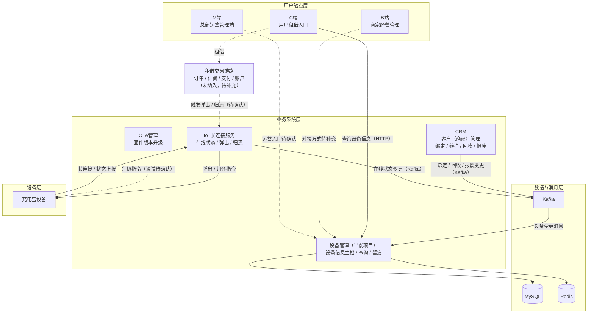
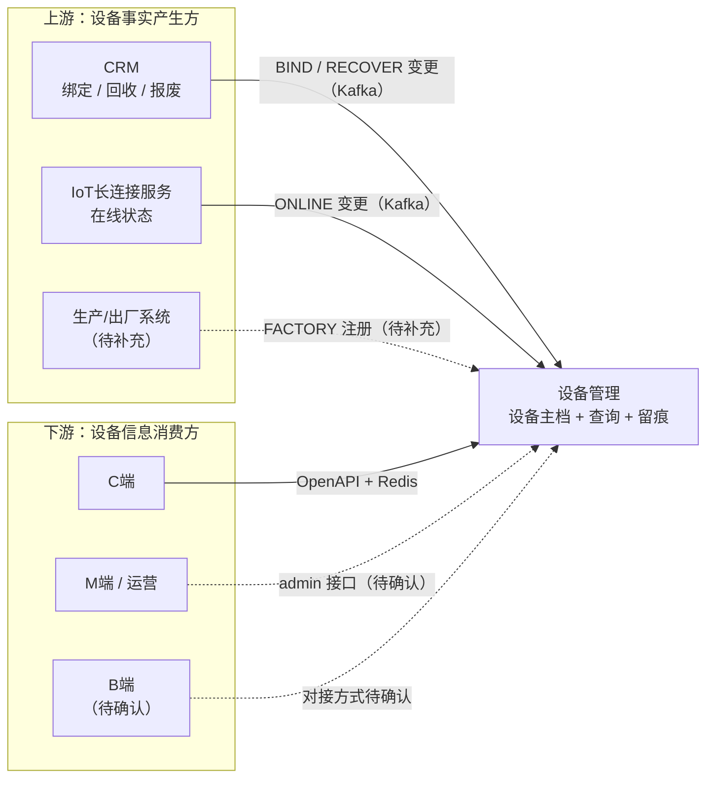
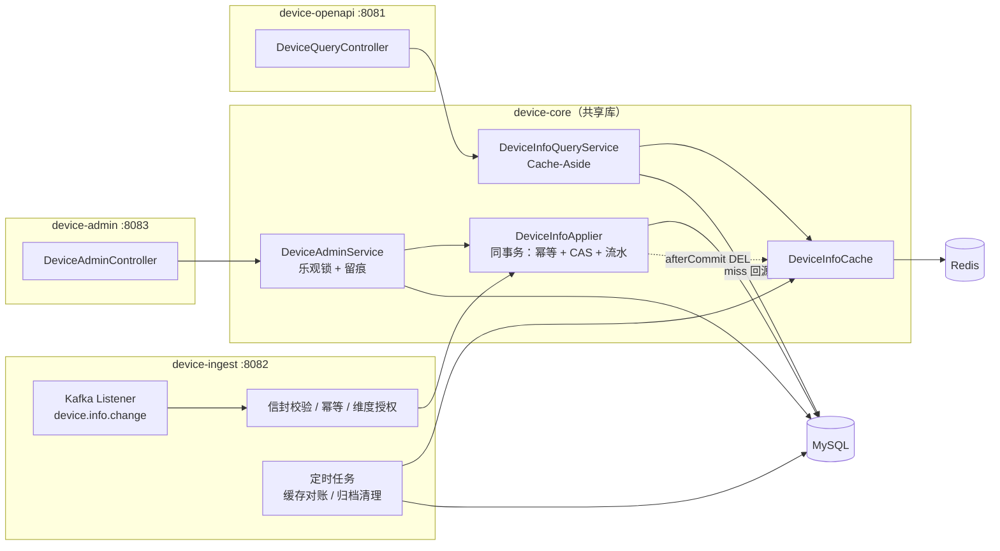
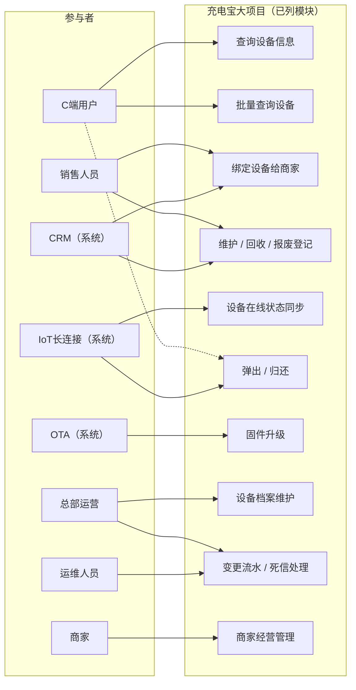
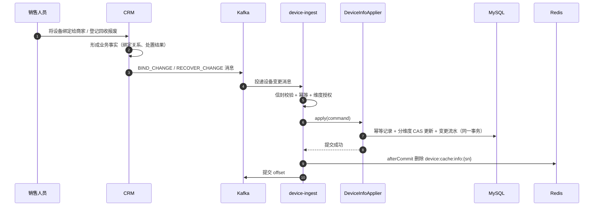
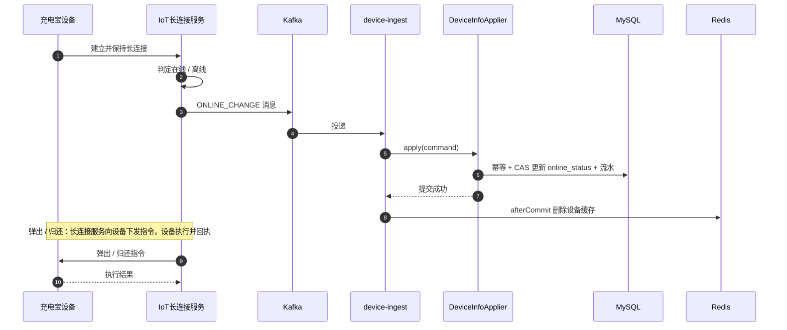
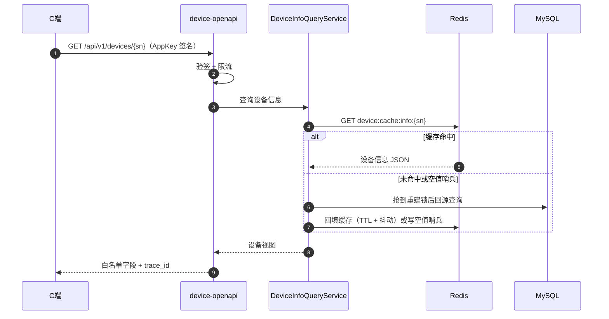
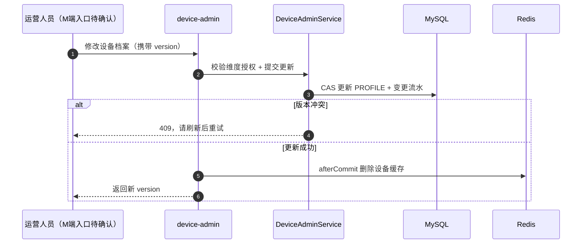
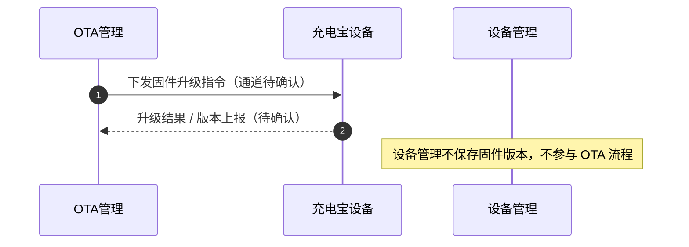

# 充电宝业务大项目 · 全景介绍与设备管理定位

> **文档性质**：项目全景介绍（模块划分 + 交互关系 + 文字说明）
> **当前仓库**：`device_management`（IoT设备端 · 设备管理）
> **覆盖范围**：C端、B端、M端、CRM、IoT设备端（设备管理、IoT长连接服务、OTA管理）
> **更新日期**：2026-10-31
> **事实基线**：需求方 2026-10-31 说明 + 当前仓库代码 + [技术设计文档](../.aisdd/workspaces/session_20261029_102105/tech-design.md)

---

## 0. 阅读说明

### 0.1 本文回答什么

1. 充电宝业务大项目由哪些端和系统组成，各自负责什么。
2. 当前仓库 `device_management` 在大项目中的准确位置：它承接谁的数据、服务谁、不做什么。
3. 各模块之间的主要交互关系，以及设备状态从产生到可查询的完整链路。

**本文不展开**：接口字段、DDL、配置参数、部署拓扑等实现细节。这些内容以 [技术设计文档](../.aisdd/workspaces/session_20261029_102105/tech-design.md)、[数据模型](../.aisdd/workspaces/session_20261029_102105/data-model/data-model.md)、[API 契约](../.aisdd/workspaces/session_20261029_102105/contracts/api-contract.yaml) 为准。

### 0.2 范围约定

| 类型 | 内容 |
|------|------|
| 已纳入 | C端、B端、M端、CRM、IoT设备端（设备管理、IoT长连接服务、OTA管理）、充电宝设备 |
| 明确未纳入 | 交易、订单、计费、支付、账户、营销等租借核心域 |
| 待补充 | 生产/出厂系统；B端与M端的具体功能及对接方式；各上游系统的消息 `source` 编码 |

> 图中**实线**表示已确认的交互，**虚线**表示范围外或尚待确认的交互。所有"待补充"项都是需求方尚未给出的信息，本文不虚构。

---

## 1. 结论先行

| 问题 | 结论 |
|------|------|
| 当前项目是什么 | IoT设备端的**设备信息中枢**：外部设备状态的镜像 + 统一查询出口 + 后台维护与留痕入口 |
| 谁产生设备业务事实 | CRM（绑定/回收/报废；维护流程）、IoT长连接服务（在线状态/弹出/归还）、生产/出厂系统（出厂注册，待补充）、OTA管理（固件升级） |
| 谁消费设备信息 | C端（OpenAPI + Redis 缓存）、运营/M端（后台接口）、B端（是否直连待确认） |
| 当前项目不做什么 | 不直连设备、不下发弹出/归还指令、不做 OTA、不做交易/计费/支付、不定义设备生命周期流程 |
| 当前项目的关键机制 | Kafka 异步接入 + 消费幂等 + 乐观锁 + 分维度更新 + Cache-Aside 缓存 + 变更流水 |

一句话概括：

> **设备管理不生产设备业务事实，它把上游系统的设备事实收敛成一份准确、可查、可追溯的服务端主档，并用缓存把 C端查询性能撑起来。**

---

## 2. 业务全景

### 2.1 参与角色

| 角色 | 使用的系统 | 核心诉求 |
|------|-----------|---------|
| C端用户 | C端 | 查询设备信息、租借、归还 |
| 商家 | B端 | 管理自身业务数据 |
| 销售人员 | CRM | 把设备绑定给商家，登记维护、报废、回收 |
| 总部运营人员 | M端 | 监控大盘、设备调度与运营决策 |
| 运维人员 | 设备管理后台 / 运维工具 | 排查设备数据、处理失败消息 |
| 充电宝设备 | — | 保持长连接、执行弹出/归还、上报状态 |

### 2.2 系统总览

| 端 / 系统 | 使用者 | 核心职责 | 与设备管理的关系 |
|-----------|--------|---------|-----------------|
| **C端** | 普通用户 | 租借入口；查询设备信息；发起弹出/归还（最终由 IoT 长连接服务下发到设备） | 通过设备管理 OpenAPI 查询设备信息，走 Redis 缓存加速 |
| **B端** | 商家 | 商家侧经营管理入口（具体功能清单待补充） | 是否直接调用设备管理接口待确认；按当前业务分工，设备绑定/回收/报废由销售在 CRM 完成，不在 B端 |
| **M端** | 总部运营人员 | 总部运营管理端：监控大盘、设备调度与运营决策（具体功能待补充） | 是否直接对接设备管理后台接口待确认 |
| **CRM** | 销售人员 / 客户管理人员 | 客户（商家）关系管理；把设备绑定给商家；维护、报废、回收登记 | 绑定/回收/报废变更的业务发生地，经 Kafka 通知设备管理 |
| **设备管理**（当前项目） | C端、运营、运维 | 设备信息主档、统一查询、后台维护、变更留痕、失败消息处理 | 本文主角 |
| **IoT长连接服务** | 设备、C端租借链路 | 保持设备网络连接；判定在线状态；向设备下发弹出/归还指令 | 在线状态变更经 Kafka 通知设备管理 |
| **OTA管理** | 运维 / 设备 | 设备固件版本升级 | 当前与设备管理**无数据交集**：不存固件版本、不参与升级流程 |
| **充电宝设备** | — | 执行弹出/归还、保持长连接、上报状态 | 不直连设备管理，统一经 IoT 长连接服务 |

> CRM 中的"客户"指**商家**，不是 C端用户。C端用户账户、交易、订单、计费、支付等域不在本文范围。

### 2.3 分层全景图

### 2.4 一句话业务链路

> 销售在 **CRM** 把设备绑定给商家；设备投放后由 **IoT长连接服务** 维持连接并上报在线状态；**C端** 通过 **设备管理** 的 OpenAPI 查询设备信息（Redis 缓存加速）；用户租借时由长连接服务向设备下发弹出/归还指令；设备固件升级由 **OTA管理** 独立完成。**设备管理** 只负责把 CRM、长连接、生产系统产生的设备状态准确保存下来，并对外提供稳定的查询与维护入口。

---

## 3. 模块划分

### 3.1 用户触点端

#### C端

- **定位**：普通用户租借充电宝的入口。
- **核心动作**：查询设备信息；发起租借（弹出）；归还。
- **与设备管理的关系**：通过 `GET /api/v1/devices/{sn}` 或批量查询接口读取设备信息，设备管理内部走 Redis 缓存，避免每次查询都打到 MySQL。
- **边界**：C端到 IoT 长连接之间的交易链路（订单、计费、支付等）不在本文范围；设备管理只提供设备信息，不参与租借决策与扣费。

#### B端

- **定位**：面向商家的经营管理入口。
- **核心动作**：商家管理自身业务数据（具体功能清单待补充）。
- **与设备管理的关系**：是否直接调用设备管理 OpenAPI 待确认。
- **边界**：按当前业务分工，设备的绑定、维护、报废、回收由公司销售通过 CRM 完成，**不在 B端操作**。

#### M端

- **定位**：总部运营管理端，面向总部运营人员的监控与运营管理。
- **核心动作**：监控大盘、设备调度、运营决策（具体功能清单待补充）。
- **与设备管理的关系**：可能消费设备列表、设备详情、变更流水等数据；是否直接对接 `device-admin` 待确认。

### 3.2 业务支撑系统：CRM

- **定位**：客户关系管理，客户指商家；是销售管理商家与设备归属的业务系统。
- **核心职责**：
  - 维护商家（客户）档案；
  - 将设备绑定给商家；
  - 登记设备维护、报废、回收。
- **与设备管理的关系**：CRM 是绑定、回收、报废状态变更的**业务发生地**。按当前设备管理设计，绑定/回收报废变更经 Kafka 进入 `device-ingest`，由设备管理落成设备主档中的对应状态。
- **边界**：维护单据、审批、回收报废流程都在 CRM；设备管理**不复制流程与单据**，只承接状态结果，并保留后台对设备档案的纠错留痕。

### 3.3 IoT设备端

IoT设备端由三个职责不同的模块组成，彼此不是同一个进程：

#### 设备管理（当前仓库 `device_management`）

- **定位**：设备信息中枢。
- **输入**：Kafka 中的设备变更消息（出厂注册、在线状态、绑定、回收报废、档案变更）。
- **存储**：MySQL 设备主档 + 变更流水 + 幂等记录 + 死信；Redis 设备信息缓存。
- **输出**：
  - 对外：C端设备信息查询 API；
  - 对内：运营后台设备维护 API、变更流水查询、死信重放。
- **进程形态**：`device-ingest`、`device-openapi`、`device-admin` 三个可执行进程，共用 `device-core` 领域库。

#### IoT长连接服务

- **定位**：设备连接与指令通道。
- **核心职责**：
  - 保持充电宝设备的网络长连接；
  - 判定并上报设备在线/离线状态；
  - 向设备下发弹出、归还指令。
- **与设备管理的关系**：把在线状态变更经 Kafka 通知设备管理；设备管理**不直接连接设备**，也不下发任何控制指令。

#### OTA管理

- **定位**：设备固件版本升级系统。
- **核心职责**：管理固件版本与升级任务，向设备下发升级指令。
- **与设备管理的关系**：当前**没有数据交集**。设备管理不保存固件版本、不参与升级任务、不判断设备是否需要升级。若未来需要在设备主档中查询固件版本，属于范围变更，需要单独设计。

### 3.4 职责边界矩阵

| 业务能力 | 事实主责方 | 设备管理是否承接 | 承接形式 |
|---------|-----------|-----------------|---------|
| 设备出厂注册 | 生产/出厂系统（未列出，待补充） | 是 | `FACTORY_REGISTER` 消息；当前代码允许该消息自动建档并置 `register_status` |
| 设备在线状态 | IoT长连接服务 | 是 | `ONLINE_CHANGE` 消息 → `online_status` |
| 设备-商家绑定 | CRM | 是 | `BIND_CHANGE` 消息 → `bind_status / bind_target / bind_time` |
| 回收 / 报废 | CRM | 是 | `RECOVER_CHANGE` 消息 → `recover_status / scrap_time`，**仅状态，不是流程** |
| 维护单据 / 审批流程 | CRM | 否 | 设备管理只记录后台对设备档案的最后编辑人/时间，不复制 CRM 工单 |
| 设备档案（型号/备注/图片） | 设备管理后台 | 是（自身维护） | `PROFILE` 维度更新 + 变更流水 |
| 固件版本 / OTA 升级 | OTA管理 | 否 | 当前不存固件版本、不参与升级 |
| 弹出 / 归还指令 | IoT长连接服务 | 否 | 设备管理不直连设备、不下发指令 |
| 租借订单 / 计费 / 支付 | 未纳入（交易域，待补充） | 否 | 设备管理不参与交易 |

> **口径说明**：`FACTORY_REGISTER` 自动建档是当前代码行为（`DimSpec.CREATE_IF_ABSENT` 仅包含该消息类型）；技术设计 §9.1 对"主档不存在"的描述未显式区分消息类型。本文按代码现状描述，建议后续把这一差异回写技术设计。

---

## 4. 当前项目：设备管理的定位

### 4.1 一句话定位

> **设备管理是 IoT设备端的设备信息中枢：把分散在 CRM、IoT长连接、生产系统等上游的设备事实，收敛成一份可查询、可维护、可追溯的服务端设备主档；对 C端提供带缓存的查询 API，对运营提供后台维护与留痕入口。**

### 4.2 三个角色

1. **上游变更的汇聚点**
   - CRM 的绑定/回收/报废、长连接的在线状态、生产系统的出厂注册，都经 Kafka 汇聚到 `device-ingest`。
   - 设备管理负责幂等、维度授权、乐观锁、变更留痕，保证同一台设备被多个来源并发更新时不丢数据、不互相覆盖。

2. **下游查询的统一出口**
   - C端不直接访问 CRM 或长连接的数据库，而是通过设备管理 OpenAPI 查询设备信息。
   - 查询走 Redis Cache-Aside：缓存命中直接返回；未命中回源 MySQL 并回填；空值有哨兵防穿透；击穿有重建锁；脏数据由定时对账收敛。

3. **运营维护与追溯入口**
   - 运营可后台分页查询、编辑设备档案、逻辑删除设备；
   - 可查询设备变更流水，定位"谁在什么时候改了什么"；
   - 可查询并重放失败消息（死信）。

### 4.3 上下游关系

### 4.4 内部结构

当前仓库是 Maven 多模块的**模块化单体**：一个共享领域库 + 三个可独立启动的进程。

| 模块 | 类型 | 默认端口 | 职责 | 代码位置 |
|------|------|---------|------|---------|
| `device-core` | 共享库 | — | 实体、Mapper、设备主档写入、查询服务、缓存、鉴权、公共 Web 组件 | [device-core](../device-core) |
| `device-ingest` | 可执行进程 | 8082（管理端口 9091） | Kafka 消费、幂等/维度校验、定时对账与归档 | [device-ingest](../device-ingest) |
| `device-openapi` | 可执行进程 | 8081（管理端口 9090） | C端设备查询 API、签名验签、限流 | [device-openapi](../device-openapi) |
| `device-admin` | 可执行进程 | 8083（管理端口 9092） | 后台设备增删改查、变更流水、死信处理 | [device-admin](../device-admin) |

> 三个进程共用同一个 MySQL 与 Redis 实例；实体与核心写逻辑只在 `device-core` 中定义，禁止各进程各自实现一套写入逻辑。

### 4.5 能力边界

**设备管理负责：**

- 设备信息主档的建账、查询、维护、逻辑删除；
- 外部变更消息的幂等消费、维度授权校验、乐观锁更新；
- 设备信息缓存与数据库的最终一致（主动删除 + TTL + 定时对账）；
- 设备变更流水、失败消息死信与人工重放；
- 对外查询的签名鉴权、限流、字段白名单。

**设备管理不负责：**

- ❌ 不直接连接充电宝设备，不维护设备长连接；
- ❌ 不下发弹出、归还等设备控制指令；
- ❌ 不保存固件版本，不执行 OTA 升级；
- ❌ 不创建租借订单，不做计费、支付、账户；
- ❌ 不定义设备生命周期流转规则（回收/报废只是外部推送的状态列）；
- ❌ 不复制 CRM 的维护工单与审批流程。

---

## 5. 交互图

### 5.1 用例图

> Mermaid 没有原生用例图，以下用"参与者 + 用例分区"近似表达，语义由 5.2 用例表兜底。

### 5.2 用例表

| 用例 | 主要参与者 | 承载系统 | 设备管理的参与方式 |
|------|-----------|---------|-------------------|
| UC-01 查询设备信息 | C端用户 | 设备管理 | OpenAPI 查询 + Redis 缓存 |
| UC-02 批量查询设备 | C端用户 | 设备管理 | 批量查询接口，一次 MGET + 一次 IN 查询 |
| UC-03 绑定设备给商家 | 销售人员 | CRM | CRM 产生 `BIND_CHANGE`，设备管理落库 |
| UC-04 维护/回收/报废登记 | 销售人员 | CRM | CRM 产生 `RECOVER_CHANGE`，设备管理落库 |
| UC-05 设备在线状态同步 | IoT长连接服务 | IoT长连接服务 | 产生 `ONLINE_CHANGE`，设备管理落库 |
| UC-06 弹出/归还 | C端用户（最终由设备执行） | IoT长连接服务 | 不参与 |
| UC-07 固件升级 | OTA管理 | OTA管理 | 不参与 |
| UC-08 设备档案维护 | 总部运营 / 运营人员 | 设备管理后台 | `device-admin` 更新 PROFILE + 写流水 |
| UC-09 变更流水/死信处理 | 运营 / 运维 | 设备管理后台 | 查询流水、重放/丢弃死信 |
| UC-10 商家经营管理 | 商家 | B端 | 待确认 |

### 5.3 主要交互清单

| 编号 | 交互 | 发起方 | 接收方 | 通道 | 状态 |
|------|------|--------|--------|------|------|
| I-01 | C端查询设备信息 | C端 | 设备管理 | HTTP（OpenAPI） | 已确认 |
| I-02 | CRM 绑定/回收/报废变更 | CRM | 设备管理 | Kafka | 已确认（`source` 编码待确认） |
| I-03 | 长连接在线状态变更 | IoT长连接服务 | 设备管理 | Kafka | 已确认（`source` 编码待确认） |
| I-04 | 出厂注册变更 | 生产/出厂系统 | 设备管理 | Kafka | 待补充 |
| I-05 | 弹出/归还指令 | IoT长连接服务 | 充电宝设备 | 设备长连接 | 已确认 |
| I-06 | 固件升级指令 | OTA管理 | 充电宝设备 | 待确认 | 待补充 |
| I-07 | 运营查询/维护设备 | M端 / 运营 | 设备管理 | HTTP（admin） | 待确认 |
| I-08 | 商家侧设备数据 | B端 | 设备管理 | 待确认 | 待补充 |
| I-09 | C端租借触发弹还 | C端 | 交易链路 → 长连接 | 待补充 | 范围外 |

### 5.4 状态同步：CRM 绑定/回收/报废

> 说明：消息类型取自现有设备管理契约；CRM 侧真实 `source` 编码以 `device_dim_source_auth` 授权表为准，待接入时确认。

### 5.5 在线状态与弹出/归还：IoT长连接服务

> 设备管理只承接"在线状态"这一结果，不参与弹出/归还指令的下发与回执。

### 5.6 C端查询设备信息

> 缓存口径：**主动删除负责快、TTL 兜底负责错、定时对账负责补**。对外不承诺强一致，脏读窗口取决于对账周期配置。

### 5.7 运营维护与留痕

> 后台写与外部推送共用同一套乐观锁与变更流水；区别是后台冲突时**直接提示刷新，不静默重试**，避免用过期内容覆盖外部最新值。

### 5.8 OTA 升级：与设备管理的边界

> OTA 是 IoT设备端的独立模块。设备管理当前既不读也不写固件信息；如果未来需要"按固件版本查设备"，需要新增数据字段与上游契约，属于范围变更。

---

## 6. 端到端场景串联

以一台设备 `PB2026102900001` 为例，串起各模块：

1. **出厂注册**
   - 生产/出厂系统（待补充）产生 `FACTORY_REGISTER` 消息。
   - 设备管理消费后自动建档（当前代码行为），写入工厂编码/名称、生产时间等 FACTORY 维度字段，并置 `register_status=1`；型号/备注/图片属于 PROFILE 维度，不在该消息的写入范围内。
   - 若设备已由运营后台提前建档，则按 FACTORY 维度更新，不重复建档。

2. **绑定商家**
   - 销售在 CRM 将设备绑定给商家。
   - CRM 产生 `BIND_CHANGE` 消息；设备管理落 `bind_status=1`、`bind_target`、`bind_time`，并写变更流水、删除设备缓存。

3. **投放与在线**
   - 设备投放后与 IoT 长连接服务建立连接。
   - 长连接服务判定在线并产生 `ONLINE_CHANGE`；设备管理更新 `online_status`。

4. **C端查询与租借**
   - C端通过设备管理 OpenAPI 查询设备信息，命中 Redis 直接返回；未命中回源 MySQL 并回填。
   - 用户租借时，由长连接服务向设备下发弹出/归还指令；设备管理只提供设备信息，不参与交易与设备控制。

5. **固件升级**
   - OTA管理独立发起升级，向设备下发升级指令。
   - 设备管理全程不参与，也不保存固件版本。

6. **维护 / 回收 / 报废**
   - 销售在 CRM 登记维护、回收或报废。
   - CRM 产生 `RECOVER_CHANGE` 消息；设备管理更新 `recover_status`、`scrap_time`，并保留变更流水。
   - 回收/报废在设备管理中**只是状态列**，不是审批流或生命周期状态机。

7. **运营追溯**
   - 运营可在设备管理后台按 SN 查询设备详情与变更流水，定位每一次状态变化的来源、消息 ID、前后值。
   - 消费失败的消息进入死信，可由运维查询并重放。

---

## 7. 数据权责与一致性

### 7.1 三类数据，三种角色

| 数据 | 归属 | 说明 |
|------|------|------|
| 业务事实 | CRM、IoT长连接、生产/出厂系统、OTA | 绑定关系、在线状态、出厂信息、固件版本等由各自系统产生并负责 |
| 设备主档 | 设备管理 | 外部事实的服务端镜像；用于统一查询、后台维护、变更追溯 |
| 查询缓存 | Redis | 仅用于加速 C端查询，不是事实来源；可丢失、可重建 |

### 7.2 写侧正确性

- Kafka 至少一次投递，重复是常态；
- 幂等两层：Redis 处理中键挡并发 + 数据库唯一索引保正确性；
- 乐观锁：同一设备并发更新时用 `version` CAS，冲突重试有上限；
- 分维度更新：一条消息只更新它负责的列，避免不同来源互相覆盖；
- 幂等记录、主档更新、变更流水在同一事务内提交；提交后才删除缓存。

### 7.3 读侧性能与一致性

- Cache-Aside：先读缓存，未命中回源数据库并回填；
- TTL + 随机抖动防雪崩；
- 空值哨兵防穿透；
- 重建锁防击穿；
- 定时对账按 `update_time` 增量比对并删除脏缓存；
- 对外口径为**最终一致**，窗口取决于对账周期，不承诺强一致。

### 7.4 故障影响

| 故障 | 对业务的影响 | 现有防线 |
|------|-------------|---------|
| CRM 不可用 | 新的绑定/回收/报废变更停止，设备管理仍可查询旧值 | 上游恢复后补推；设备管理幂等消费 |
| 长连接服务不可用 | 在线状态停止更新，弹出/归还不可用 | 设备管理仍可查询；长连接恢复后继续上报 |
| Kafka 积压 | 设备信息更新滞后 | 消费扩容、lag 告警、缓存与对账 |
| Redis 不可用 | 查询回源 MySQL，压力上升 | 回源 + 限流 + 超时 fail-fast；写侧幂等退化到数据库唯一索引 |
| MySQL 不可用 | 设备管理读写不可用，C端查询可能失败 | 依赖超时 + 503；无降级写路径 |
| OTA 不可用 | 不影响设备管理查询、绑定、回收报废 | 模块独立 |

---

## 8. 边界与待补充

| # | 待补充 / 未纳入 | 影响 | 当前处理 |
|---|----------------|------|---------|
| 1 | 交易、订单、计费、支付、账户等租借核心域 | C端租借闭环的上游链路 | 本文不展开；全景图中以"租借交易链路（未纳入）"标注 |
| 2 | 生产/出厂系统的名称、消息契约 | `FACTORY_REGISTER` 的来源与自动建档规则 | 当前代码允许该消息自动建档；系统名称与 `source` 编码待确认 |
| 3 | B端具体功能与是否直连设备管理 | B端与设备管理的交互方式 | 图中虚线标注，暂不画实线 |
| 4 | M端具体功能与是否直连 `device-admin` / OpenAPI | 运营侧数据消费方式 | 图中虚线标注，待确认 |
| 5 | CRM 的真实 `source` 编码与消息生产细节 | 维度授权表配置、消息接入 | 以 `device_dim_source_auth` 配置为准，接入时确认 |
| 6 | IoT长连接服务的 `source` 编码与在线判定口径 | 在线状态消息接入 | 同上 |
| 7 | OTA 与设备管理未来是否需要在固件版本上产生交集 | 若需要则是范围变更 | 当前明确不存固件版本 |
| 8 | 设备形态（机柜/充电宝本体）、部署规模、SLA | 容量规划与部署方案 | 技术设计中的量级为假设值，待压测与业务确认 |

---

## 附录 A：术语表

| 术语 | 说明 |
|------|------|
| 设备 | 充电宝设备；本文中设备管理只管理设备信息，不管理设备控制 |
| 设备主档 | `device_info` 表，外部设备事实在服务端的镜像 |
| 维度 | 一组由同一权威来源整体改写的字段：FACTORY / ONLINE / BIND / RECOVER / PROFILE / MAINTAIN |
| 维度所有权 | `(dim_type, source)` 授权关系，决定某来源能否写某维度 |
| 变更流水 | `device_info_change_record`，记录每次变更的来源、消息 ID、前后值、结果 |
| 幂等 | 同一条消息重复投递不产生重复副作用；Redis 挡并发 + 数据库唯一索引保正确性 |
| 乐观锁 | 用 `version` 做 CAS 更新，影响行数为 0 即冲突 |
| Cache-Aside | 读缓存 → 未命中回源 → 回填；写库 → 删除缓存 |
| 空值哨兵 | 缓存中写入 `__EMPTY__` 表示"确认不存在"，防止缓存穿透 |
| 死信 | 消费失败且超过重试上限的消息，落库后可查询、可重放 |
| 租借交易域 | 订单、计费、支付、账户等；本文明确未纳入 |

## 附录 B：参考文档

- [设备管理技术设计](../.aisdd/workspaces/session_20261029_102105/tech-design.md)
- [设备管理数据模型](../.aisdd/workspaces/session_20261029_102105/data-model/data-model.md)
- [设备管理 API 契约](../.aisdd/workspaces/session_20261029_102105/contracts/api-contract.yaml)
- [设备管理实现映射](../.aisdd/workspaces/session_20261029_102105/implementation-map.md)
- 代码模块：[device-core](../device-core) · [device-ingest](../device-ingest) · [device-openapi](../device-openapi) · [device-admin](../device-admin)
